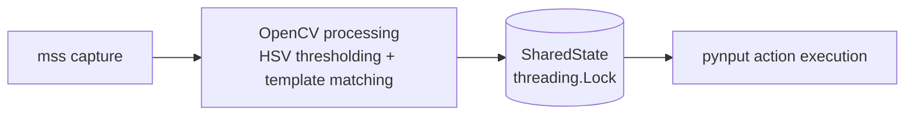

# MushroomGameHelper

A classical computer-vision automation framework for a 2D pixelated
side-scroller. It watches a screen region, estimates health and mana bar
levels, detects sprites, and issues keyboard input, using decoupled threads for
perception and action. It was also built as a learning project for `Tkinter`,
`mss`, `OpenCV`, `pynput` and GitHub Copilot's agentic capabilities.

## Key Features

- **Real-time screen capture** of a configurable region with `mss`.
- **Interactive ROI calibration** (`calibrator.py`) for the health and mana bars.
- **Temporal median filtering** of bar percentages (rolling window of 4 frames)
  to suppress flashing and opacity artifacts.
- **Decoupled threads**: vision at 250 ms (~4 FPS), action at 100 ms (~10 Hz).
- **Per-key cooldowns** to prevent input spamming.
- **Tkinter GUI** with live status and persistent settings.

## Architecture



| Module | Role |
| --- | --- |
| `config.py` | Typed dataclass configuration; loads `calibration.json` if present, otherwise defaults. |
| `vision.py` | Capture, `cv2.matchTemplate`, `cv2.inRange`, bar percentages, median filter. |
| `state.py` | Lock-protected shared dictionary bridging the two threads. |
| `action.py` | Key presses/holds via `pynput`, threshold logic and cooldowns. |
| `main.py` | `Runner` managing both threads; Ctrl+C triggers graceful shutdown. |
| `gui.py` | Tkinter front end. |
| `calibrator.py` | Interactive OpenCV calibration tool. |

The vision thread writes `health_percent`, `mana_percent`, `health_low`,
`mana_low`, `targets_visible` and `matches` to `SharedState`; the action thread
reads a consistent snapshot every tick and presses keys subject to cooldowns.

## Prerequisites and Installation

Python **3.10 or newer** is required (the code uses `X | None` type syntax).

```bash
python -m pip install --upgrade pip
pip install -r requirements.txt
```

### Installing Tkinter

`Tkinter` is not installable through `pip`; it is bundled with the interpreter.

| OS | Instructions |
| --- | --- |
| Ubuntu / Debian | `sudo apt-get install python3-tk` |
| Fedora | `sudo dnf install python3-tkinter` |
| Windows | Built in (keep "tcl/tk and IDLE" ticked in the python.org installer). |
| macOS | Built in with python.org installers; with Homebrew run `brew install python-tk`. |

Verify with:

```bash
python -c "import tkinter; print('ok')"
```

**Note:** `pynput` requires a graphical session (an X server on Linux, and
accessibility/input-monitoring permission on macOS).

## Step-by-Step Setup and Testing Workflow

### Step 1: Define the Capture Region

Set the region so that it isolates the game window. In `calibration.json` (or
via the GUI fields **Top**, **Left**, **Width**, **Height**) or the defaults in
`config.py`:

```python
CAPTURE_TOP: int = 0
CAPTURE_LEFT: int = 0
CAPTURE_WIDTH: int = 800
CAPTURE_HEIGHT: int = 600
```

Coordinates are in pixels relative to the primary monitor. Run the game in
windowed mode at a fixed size and position.

### Step 2: Interactive Calibration (Health and Mana)

```bash
python calibrator.py
```

A screenshot of the capture region opens in an OpenCV window. For **Health**
and then **Mana**:

1. **Click and drag** to draw a rectangle (ROI) tightly around the bar.
2. **Click** a pixel in the *full / occupied* part of the bar (inside the ROI).
3. **Click** a pixel in the *empty / background* part of the bar (inside the ROI).

Press **r** to redo the current bar, **q** or **Esc** to abort without saving.
Sampled colors are converted to HSV and expanded by ±15 hue and ±40
saturation/value. Then, in the terminal, enter for each bar:

```text
Enter Health % threshold [0-100]:
Key to press when Health is low:
Health cooldown in seconds [0-3600]:
```

(and likewise for Mana). The result is written to `calibration.json` in the
repository root. **Re-run the calibrator whenever the game resolution, UI scale
or capture region changes.**

### Step 3: Template Setup

1. Crop the sprite from a screenshot at native resolution (no scaling) and save
   it as PNG, e.g. `templates/slime.png`.
2. Register it in `config.py`:

   ```python
   TEMPLATES: Dict[str, str] = {"slime": "templates/slime.png"}
   ```

3. Optionally override the confidence per template with
   `TEMPLATE_THRESHOLDS = {"slime": 0.9}`.

Matches are published as `matches["slime"] = [(x, y, confidence), ...]`.
Missing template files are skipped silently.

### Step 4: Execution

Headless (stop with **Ctrl+C**):

```bash
python main.py
```

With the GUI:

```bash
python main.py --gui
# or
python gui.py
```

In the GUI, edit the capture region and match threshold, then press **Start**.
The live panel shows health and mana percentages and low flags, and the
visible-target state.

## Configuration Reference

### `config.py`

| Parameter | Default | Meaning |
| --- | --- | --- |
| `VISION_INTERVAL` | `0.25` s | Vision loop period (~4 FPS). |
| `ACTION_INTERVAL` | `0.10` s | Action loop period (~10 Hz). |
| `SMOOTHING_WINDOW` | `4` | Frames in the median filter (1 s at 250 ms). |
| `MATCH_THRESHOLD` | `0.80` | Template match confidence (0-1). |
| `TEMPLATE_THRESHOLDS` | `{}` | Per-template confidence overrides. |
| `KEYBINDS` | see file | Logical-name to key mappings for other actions. |
| `DEFAULT_PRESS_DURATION` | `0.05` s | Key hold time for a tap. |

Health and mana settings (including cooldowns) live in `calibration.json`.

### `calibration.json`

```json
{
  "capture": {"top": 0, "left": 0, "width": 800, "height": 600},
  "match_threshold": 0.8,
  "health": {
    "roi": [10, 12, 120, 10],
    "full_lower": [0, 150, 150],  "full_upper": [10, 255, 255],
    "empty_lower": [0, 0, 0],     "empty_upper": [10, 40, 60],
    "threshold_percent": 40.0,
    "keybind": "h",
    "cooldown": 1.0
  },
  "mana": { "...": "same fields as health" }
}
```

- `roi`: `[x, y, width, height]` relative to the capture region.
- `*_lower` / `*_upper`: HSV bounds (OpenCV scale: H 0-179, S/V 0-255) for the
  occupied and empty colors.
- `threshold_percent`: the bar counts as *low* below this percentage.
- `keybind`: a single character or `pynput` key name (e.g. `space`, `f1`).
- `cooldown`: minimum seconds between presses of that key.

### Percentage and temporal median filter

Per frame, `percent = 100 · occupied / (occupied + empty)` over the ROI. Pixels
matching neither color (borders, text, glow) are ignored. Flashing bars make
single readings jump (e.g. 20, 100, 20, 100), so the last 4 readings are kept
and their **median** is reported. Unlike the mean, the median tolerates outliers:
a single flashed frame never changes the result, and a real change takes over
once it fills about half of the window (~0.5-1 s). Frames where neither color is
found are skipped rather than treated as 0%.

## Troubleshooting and Known Limitations

- **Stuck keys:** held keys are released on **Ctrl+C**, on GUI **Stop**, and when
  the GUI window is closed. If the process is killed forcibly (e.g. `kill -9`),
  release them manually.
- **Dropped inputs / game debouncing:** some engines ignore very short presses
  or rapid repeats. Increase `DEFAULT_PRESS_DURATION`, raise the per-key
  `cooldown` in `calibration.json`, or increase `ACTION_INTERVAL`.
- **Bar always reads 0 or 100 %:** the ROI or HSV ranges are off; recalibrate and
  make sure the game window did not move.
- **Hue wrap-around:** reds near hue 0/179 are clipped, not wrapped, so a
  red bar may need manual adjustment of the HSV bounds.
- **GUI settings:** edits are saved to `calibration.json` when you press **Stop**
  or close the window; **settings changed during a live session persist only
  after that**, and a hard crash loses them.
- **Latency:** the median filter adds up to about 1 s of delay in reacting to
  genuine changes.
- **Permissions:** on macOS and Wayland, input simulation and screen capture
  may be blocked; use an X11 session on Linux.
- Use responsibly and only in games whose terms permit automation.
A project to learn `Tkinter`, `mss`, `OpenCV`, `pynput` and GitHub Copilot agentic capabilities.

An excuse to make my life easier in a certain mushroom game. * WINK WINK *
