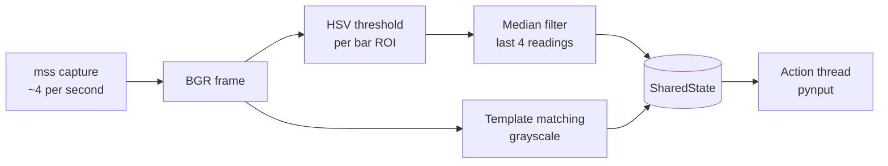
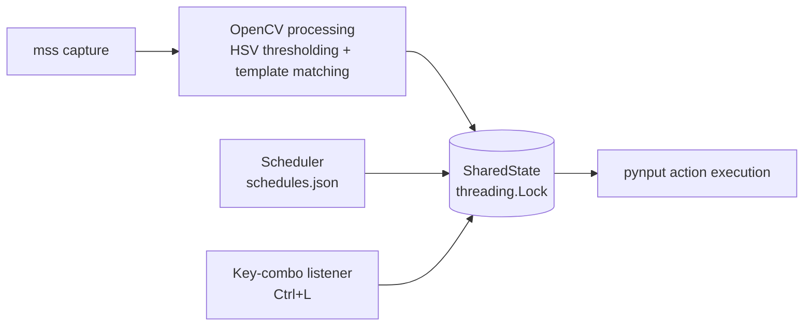

<div align="center">

# 🍄 MushroomGameHelper

**A classical computer-vision assistant for 2D pixelated games: it watches your screen, reads your health and mana bars, and presses the right keys at the right time.**


</div>

## Elevator Pitch

MushroomGameHelper takes a picture of a rectangle of your screen four times a second, measures how full your **health** and **mana** bars are using plain colour maths (no machine learning), and presses your potion keys when a bar runs low. It can also press buffs on a timer, and hold a loot key for you.

| Layer | Technology | What it does here |
| --- | --- | --- |
| Capture | `mss` | Grabs the configured screen region. |
| Vision | `OpenCV` + `NumPy` | HSV colour thresholding for bars, template matching for sprites. |
| Input | `pynput` | Presses/holds keys and listens for the looting hotkey. |
| Interface | `Tkinter` | Tabbed GUI (**Dashboard**, **Calibrate Bars**, **Manage Buffs**) and an optional overlay. |
| Language | Python 3.10+ | Three cooperating threads: vision, scheduler, action. |

> [!NOTE]
> This project was built for learning and reliability. Use it responsibly and only in games whose terms of service permit automation.

---

## Table of Contents

1. [🚀 The "Foolproof" Quick Start](#quick-start)
2. [🖥️ The Unified GUI Workflow](#gui-workflow)
3. [🧠 Advanced Features Deep-Dive](#advanced)
4. [🛡️ OS-Specific Survival Guide](#os-guide)
5. [🩺 Troubleshooting Matrix](#troubleshooting)
6. [📁 Files, Commands and Configuration Reference](#reference)
7. [🏗️ Architecture](#architecture)

---

<a id="quick-start"></a>

## 🚀 The "Foolproof" Quick Start (TL;DR)

- [ ] **Step 1: Install.** You need **Python 3.10 or newer**. Open a terminal in the project folder (the one containing `main.py`) and run:

  ```bash
  python -m pip install --upgrade pip
  pip install -r requirements.txt
  ```

  Then make sure Tkinter works (it is **not** installable with `pip`):

  ```bash
  python -c "import tkinter; print('Tkinter OK')"
  ```

  If that prints an error, install Tkinter for your system:

  | OS | Command / action |
  | --- | --- |
  | **Windows** | Built in. If missing, re-run the python.org installer and tick **tcl/tk and IDLE**. |
  | **macOS** | Built in with python.org installers. With Homebrew: `brew install python-tk` |
  | **Ubuntu / Debian** | `sudo apt-get install python3-tk` |
  | **Fedora** | `sudo dnf install python3-tkinter` |

- [ ] **Step 2: Prepare the game.** Run it in **Windowed** or **Borderless Windowed** mode (not exclusive fullscreen). Put the window where you want it and **leave it there**. Make sure your health and mana bars are visible.
- [ ] **Step 3: Launch the app.**

  ```bash
  python main.py --gui
  ```

- [ ] **Step 4: Follow the GUI.** On a first run the app jumps to the **Calibrate Bars** tab and keeps **Start** disabled. Click **Launch Bar Calibrator**, calibrate Health and Mana, answer the questions in your terminal, and **Start** unlocks. Then press **Start** on the **Dashboard**.

> [!TIP]
> Keep the terminal you launched the app from visible but **not on top of the game bars**: you will need it to answer the calibrator's questions (see [Tab 2](#tab-2-calibrate-bars)).

---

<a id="gui-workflow"></a>

## 🖥️ The Unified GUI Workflow (Core Setup)

`python main.py --gui` is the **single entry point** for everything: setup, calibration, buff management and running the bot. (`python gui.py` is an equivalent shortcut.)


The window has three tabs:

| Tab | Purpose |
| --- | --- |
| **Dashboard** | Capture region, **Start**/**Stop**, and the live status panel. |
| **Calibrate Bars** | Teach the bot where your health and mana bars are and what colours they use. |
| **Manage Buffs** | Add, toggle and delete timed buff/potion schedules. |

### First-run check

When the window opens, the app verifies that `calibration.json` exists and that the **Health** and **Mana** bar rectangles are real (positive size and not the built-in placeholders). If not:

- the **Start** button is disabled,
- the status line reads *"Setup Incomplete: Please calibrate your bars in the 'Calibrate Bars' tab before starting."*,
- the **Calibrate Bars** tab is selected for you.

### Tab 1: Dashboard


| Control | Meaning |
| --- | --- |
| **Top**, **Left** | Pixel position of the capture rectangle's top-left corner, relative to the primary monitor. |
| **Width**, **Height** | Size of the capture rectangle in pixels (must be at least 1). |
| **Match threshold** | Template-matching confidence from `0` to `1` (default `0.8`). |
| **Game Window Title** | Optional. Leave blank to use the fixed coordinates above; enter the game's window title for auto-tracking. See [Dynamic Window Tracking](#dynamic-window-tracking). |
| **Start** | Validates the fields, re-checks calibration, and starts the vision, scheduler and action threads. |
| **Stop** | Stops all threads, releases any held key, and saves your settings to `calibration.json`. |

**Live status panel** (refreshed 4 times per second):

```text
Targets visible: False
Health: 85% (low: False)
Mana: 40% (low: True)
Matches: -
Buffs:
  Attack Buff [f1] every 180s - next in 62.3s
Looting: Inactive (Press ctrl+l to toggle)
```

The last line is the **looting toggle status**: it shows `Looting: ACTIVE` while the loot key is being held, otherwise `Looting: Inactive` plus the hotkey chord to press.

> [!NOTE]
> The panel shows `Health: 0%` before you press **Start** because vision has not reported yet. That is normal.

Settings are saved to `calibration.json` when you press **Stop**, when you close the window, and just before the calibrator launches. Closing the window also stops the bot and releases all keys.

### Tab 2: Calibrate Bars


Click **Launch Bar Calibrator**. The main window hides itself, `calibrator.py` starts, and a screenshot of your capture region opens in an OpenCV window titled **Calibrator**. The label on the tab reminds you: *"Calibration saves directly to calibration.json"*.

> [!IMPORTANT]
> The screenshot is taken the moment the calibrator starts. If **Game Window Title** is set and the window is found, the calibrator captures **that window** (and records its position and size in `calibration.json`); otherwise it uses the fixed **Top / Left / Width / Height** values from the **Dashboard**. Make sure the game (with both bars visible) is on screen and nothing, including your terminal, covers it.

For **Health** first, then **Mana**, repeat these three actions (the instruction text at the top-left of the image tells you which one is next):

1. **Drag the ROI.** Click and drag a tight rectangle around the bar. (ROI = *region of interest*.)
2. **Click Full.** Click one pixel in the **filled** part of the bar, inside your rectangle.
3. **Click Empty.** Click one pixel in the **empty** (background) part of the bar, also inside your rectangle.

Clicks outside the rectangle are ignored. Keys in the OpenCV window:

| Key | Effect |
| --- | --- |
| **r** | Redo the bar you are currently on. |
| **q** or **Esc** | Cancel; nothing is saved. |
| Closing the window with the title-bar button | Also cancels; nothing is saved. |

**Then answer the terminal prompts** (the OpenCV window closes and the calibrator asks, for each bar):

```text
Enter Health % threshold [0-100]:
Key to press when Health is low:
Health cooldown in seconds [0-3600]:
```

and the same three questions for Mana. For example `40`, `h`, `1` means "when Health drops below 40 %, press `h`, but not more often than once per second".

When the calibrator finishes, the **Calibrate Bars** tab detects that it exited, re-reads `calibration.json`, brings the main window back, enables **Start** and returns you to the **Dashboard**. If you cancel, the main window comes back too and nothing changes.

> [!WARNING]
> **Do not resize the game window, and do not move it unless [Dynamic Window Tracking](#dynamic-window-tracking) is on.** The bar positions are stored as pixel offsets inside the capture rectangle. Without tracking, a moved window makes the bot look at the wrong place and read nonsense; with tracking, moving is safe but **resizing or changing the in-game resolution still requires recalibration**. Also recalibrate after any change of UI scale.

> [!TIP]
> Calibrate while a bar is steady (not flashing). Click the middle of the filled and empty parts, away from borders, text and glow. You must **Stop** the bot before launching the calibrator, and you must start the app from a terminal so the prompts have somewhere to appear.

### Tab 3: Manage Buffs


This tab replaces the old `buff_setup.py` command-line script. It edits `schedules.json` for you.

| Column | Meaning |
| --- | --- |
| **Name** | A unique label, for example `Attack Buff`. |
| **Keybind** | One character (`f`) or a key name (`f1`, `space`). |
| **Interval** | Seconds between automatic presses (greater than 0). |
| **Enabled** | `Yes` or `No`. Disabled schedules are kept but never fire. |

- **Add** opens a small form for **Name**, **Keybind** and **Interval (s)**; click **Save**. Empty fields, a non-positive interval, or a duplicate name are rejected with a message.
- **Toggle**: select a row, then click **Toggle** to enable or disable it.
- **Delete**: select a row, then click **Delete**.

The table is reloaded from `schedules.json` every time you open the tab, and every change is written immediately.

> [!NOTE]
> The scheduler reads `schedules.json` **when the bot starts**. After changing buffs, press **Stop** and then **Start**. A buff that has never fired is due **immediately** after **Start**, then every *Interval* seconds.

### Dynamic Window Tracking

**No more broken bots if you accidentally move the game window!** Instead of capturing a fixed rectangle of your desktop, the bot can find the game window by its title and follow it wherever you drag it.

#### Step-by-step: find your exact window title

1. Start the game and leave it open (not minimized).
2. Find the title text:
   - **Windows (easiest):** look at the **title bar** at the top of the game window and copy the text exactly. If there is no title bar (borderless), hover over the game's icon in the taskbar and read the name shown.
   - **Windows (Task Manager):** press **Ctrl + Shift + Esc**, open the **Details** tab and find the game's `.exe`. The **Name** column shows the program file name, which is often similar to, but not always the same as, the window title. If in doubt, trust the title bar.
   - **macOS / Linux:** read the text in the window's title bar. Note that [tracking is mostly Windows-only](#os-guide).
3. Open the **Dashboard** tab and type that text into **Game Window Title**. Copy and paste to avoid typos; capitalisation does not matter.
4. Press **Start** (or go to **Calibrate Bars** and calibrate). The first time it works you will see a line like `Capture region set from window 'MyGame': {...}` in the terminal and in `bot_session.log`.

> [!TIP]
> An **exact** title match is preferred. If there is none, the first window whose title **contains** your text is used, so `MyGame` also matches `MyGame - Level 3`. Make the text specific enough not to match another window (a browser tab named after the game, for example).

Leave the field **blank** to keep using the fixed **Top / Left / Width / Height** values.

#### How it behaves

- The window position is checked when the bot starts and again **every 5 seconds** (`WINDOW_REFRESH_INTERVAL` in `config.py`), so after you drag the window the bot follows within 5 seconds.
- **Minimized or hidden window:** the bot keeps using the last known good position and logs a warning. When you restore the window it re-acquires it within 5 seconds. It never captures an empty or invalid region.
- **Window not found** (wrong title, no permission, unsupported OS): the bot falls back to the fixed coordinates, logs `Window '...' not found`, and keeps retrying.
- **Partly off-screen:** the capture is cropped to the part that is visible on your screens (`mss` cannot capture outside them). A warning is logged, because if the left or top edge is cut off the bars shift and may be misread; drag the window fully on-screen. A window that is entirely off-screen is treated like a minimized one.
- **Size changed:** the position and size of the window are saved when you calibrate. If the window later has a different size, a warning is logged (`Window size ... differs from the size at calibration`).

> [!WARNING]
> **Limitations.** Tracking follows the window's **position**, not the picture inside it. If you change the game's **internal resolution** or resize the window, the bars are no longer where calibration recorded them: you **must recalibrate**. If the game goes **full-screen exclusive**, it may not appear as a normal window (or may capture as black): switch to **Windowed** or **Borderless Windowed** and recalibrate. Tracking needs the `pygetwindow` package (installed by `requirements.txt`).

### Template setup (optional)

Template matching detects sprites (for example an enemy) in the capture. Matches appear in the status panel (`Targets visible`, `Matches`). **No key press currently depends on them**; they are published for your own extensions.

1. Crop the sprite from a screenshot at native size (no scaling) and save it as PNG, e.g. `templates/slime.png`.
2. Register it in `config.py`:

   ```python
   TEMPLATES: Dict[str, str] = {"slime": "templates/slime.png"}
   ```

3. Optionally set a per-template confidence: `TEMPLATE_THRESHOLDS = {"slime": 0.9}`.

Missing template files are skipped silently.

---

<a id="advanced"></a>

## 🧠 Advanced Features Deep-Dive

<details>
<summary><b>👁️ Vision Pipeline &amp; Temporal Filtering: how the bot sees</b></summary>

### The pipeline



### 1. Capture
`mss` grabs the rectangle (**Top**, **Left**, **Width**, **Height**) as a picture. The capture handle is created on, and closed by, the vision thread itself because `mss` handles belong to the thread that made them.

### 2. Reading a bar with HSV thresholding
Colours are easier to compare in **HSV** (hue = which colour, saturation = how vivid, value = how bright) than in RGB. During calibration, the two pixels you clicked become two colour ranges: *occupied* and *empty*, each ±15 hue and ±40 saturation/value around your sample. For every frame, inside the ROI only:

- `occupied` = number of pixels inside the occupied range,
- `empty` = number of pixels inside the empty range,
- `percent = 100 × occupied ÷ (occupied + empty)`.

Pixels matching neither range (borders, digits, glow) are **ignored**, so decorations don't distort the reading. A ROI that falls partly or fully outside the captured frame is clipped safely. If neither colour is found, the frame produces no reading.

### 3. The temporal median filter
Low bars in many games **flash** or change opacity, so single readings jump around (for example `20, 100, 20, 100`). If the bot reacted to every frame it would press potions at the wrong moments.

The bot therefore keeps the **last 4 readings** (`SMOOTHING_WINDOW`, about 1 s) and reports their **median**: the middle value once sorted. Analogy: if one judge in a panel of four gives a wildly different score, the middle score barely moves, whereas an *average* would be dragged along. A single flashed frame never changes the result, and a real, sustained change takes over after roughly half the window (about 0.5-1 s).

- Frames with **no reading** (bar hidden, ROI misaligned) are **skipped**, not counted as 0 %, so a hidden bar never triggers a false "low".
- Until the first valid reading, the bar is treated as **100 %** (not low).
- A bar is *low* when its filtered percentage is below its `threshold_percent`.

### 4. Template matching
Each registered template is searched in the grayscale frame with OpenCV's normalised cross-correlation (`TM_CCOEFF_NORMED`); overlapping hits are merged. Results become `matches[name] = [(x, y, confidence), ...]` and `targets_visible`.

### Known limitation
Red bars near hue 0/179 are clipped, not wrapped around the hue circle, so they may need manual edits to the `*_lower` / `*_upper` values in `calibration.json`.

</details>

<details>
<summary><b>⚔️ Looting Automation (Hold &amp; Retrigger)</b></summary>

### What it does
While looting is **ON**, the bot **holds your loot key down** (default `x`) so you can walk over drops and pick them up hands-free.

### How to switch it on and off
Press the **two-key chord** at the same time: default **Ctrl + L** (either Ctrl key works). Press it again to turn looting off, which releases the loot key immediately. The chord is detected by a background `pynput` listener, **only while the bot is running** (after **Start** or with `--osd`). Looting always starts **OFF** at each start and is switched OFF when the bot stops.

The chord fires once per press: holding the keys down does not toggle repeatedly; release and press again to toggle once more.

### Why it releases and re-presses automatically
Some game engines ignore a key that has been held down for a long time (an "ignore timer"). To stay reliable, every `retrigger_interval` seconds (default **5**) the bot **releases** the loot key, waits 50 ms so the game registers the release, then **holds it again**, and restarts the interval.

### Where to see the status
- **Dashboard:** `Looting: ACTIVE` / `Looting: Inactive (Press ctrl+l to toggle)`.
- **OSD overlay:** `Looting: ON` / `Looting: OFF`.

### Settings
Edit the `looting` section of `calibration.json` while the app is closed:

```json
"looting": {
  "keybind": "x",
  "retrigger_interval": 5.0,
  "toggle_key_1": "ctrl",
  "toggle_key_2": "l"
}
```

> [!NOTE]
> The listener and the key holder are separate on purpose: the listener only flips a flag; only the action thread ever touches the keyboard.

</details>

<details>
<summary><b>📺 On-Screen Display (OSD) &amp; Telemetry</b></summary>

### The overlay: `--osd`

```bash
python main.py --osd
```

This starts the bot threads (without the main GUI) and shows a small, borderless, semi-transparent (80 % opacity), always-on-top box at the top-left of the screen:

```text
HP: 85%
MP: 40%
Looting: OFF
Active Buffs: [Attack Buff [f1]]
```

It refreshes 4 times per second and is **read-only**. Close it with **Esc** (while it has focus) or **Ctrl+C** in the terminal; held keys are released either way.


| OS | Behaviour |
| --- | --- |
| **Windows** | Click-through: mouse clicks pass through the overlay to the game. Because it never takes focus, **Esc** does not work; use **Ctrl+C** in the terminal. |
| **Linux / macOS** | No click-through in plain Tkinter, so the overlay can take focus (so **Esc** works). Transparency needs a compositing window manager, and "always on top" may be ignored by exclusive-fullscreen games; use borderless-windowed mode. |

> [!WARNING]
> `--osd` starts the bot **without** the GUI's first-run check. Calibrate once through the GUI before using it.

### Headless mode

```bash
python main.py
```

Runs the bot with no window. Stop with **Ctrl+C**.

### Telemetry: `bot_session.log`

Every run writes a rotating log file, `bot_session.log`, in the project folder (max 5 MB per file, 3 backups). Each line has a timestamp, thread name (`vision`, `action`, `scheduler`), level and message. Useful lines to look for:

| Message | Meaning |
| --- | --- |
| `Bot session starting. Config: ...` | Settings the session started with. |
| `Triggered h due to low health` | A heal/mana key was pressed. |
| `Suppressed h press: cooldown active` | Bar is low but the cooldown has not elapsed. |
| `Scheduling buff press: f1` | A buff came due. |
| `Looting toggled: looting_active=True` | The chord was detected. |
| `bar_percent returned None for health on 3 consecutive frames` | The ROI is misaligned or the bar is hidden. Recalibrate. |
| `Window '...' not found; ...` | The **Game Window Title** did not match or the window is minimized; the last known (or fixed) region is used. |
| `Window size ... differs from the size at calibration` | The game was resized or its resolution changed. Recalibrate. |
| `Window '...' is partly off-screen; capture clamped ...` | Drag the game window fully on-screen. |
| `Error in vision: ...` | A loop iteration failed (it keeps running); the traceback follows. |

</details>

---

<a id="os-guide"></a>

## 🛡️ OS-Specific Survival Guide

Screen capture (`mss`) and keyboard control (`pynput`) are things operating systems deliberately restrict. Most "it does nothing" reports are a missing permission, not a bug.

> [!IMPORTANT]
> Key presses are sent to whatever window has focus. **Click on the game window** after pressing **Start** so it receives the keys.

### 🪟 Windows

- If the bot reads bars but the game **ignores the key presses**, run your terminal **as Administrator** (right-click → *Run as administrator*) and launch the app from there. Windows blocks a normal program from sending input to an elevated one, so if the game runs as administrator, the bot must too.
- Use **Windowed** or **Borderless Windowed** mode; exclusive fullscreen often captures a black image.
- **Game Window Title** tracking relies on `pygetwindow`, which works on Windows.

### 🍎 macOS

Grant your **terminal app** (Terminal, iTerm, VS Code, or the Python you launch from) these permissions, then **fully quit and reopen the terminal**:

| Permission | Path (macOS 13 and later) | Needed for |
| --- | --- | --- |
| **Screen Recording** | **System Settings → Privacy & Security → Screen Recording** | `mss` screen capture (without it you get a blank or desktop-only image). |
| **Accessibility** | **System Settings → Privacy & Security → Accessibility** | `pynput` pressing keys. |
| **Input Monitoring** | **System Settings → Privacy & Security → Input Monitoring** | `pynput` hearing the looting hotkey chord. |

On macOS 12 and earlier the same switches live under **System Preferences → Security & Privacy → Privacy**. Game-window tracking has limited support on macOS and falls back to the fixed region.

### 🐧 Linux

- Install Tkinter: `sudo apt-get install python3-tk` (Debian/Ubuntu) or `sudo dnf install python3-tkinter` (Fedora).
- Use an **X11 (Xorg)** session. **Wayland** blocks both screen capture and synthetic input for security, so `mss` and `pynput` typically return black images or do nothing. At the login screen choose the "on Xorg" / "X11" session.
- Game-window tracking is not available on most Linux setups (the fixed region is used), so keep the window still.

---

<a id="troubleshooting"></a>

## 🩺 Troubleshooting Matrix

| Symptom | Root Cause | Solution |
| --- | --- | --- |
| **Bot does nothing / Health reads 0 %** | (a) You haven't pressed **Start**: the panel shows `0%` until vision reports. (b) The capture region or bar ROI doesn't line up with the game, so the bar is not found. (c) A missing OS permission gives a blank capture or ignored keys. | Press **Start**. Check **Top / Left / Width / Height**, then re-run the calibrator. Look in `bot_session.log` for `bar_percent returned None`. Follow the [OS-Specific Survival Guide](#os-guide). Click the game window so it has focus. |
| **Keys are stuck down** | The process was killed abruptly (for example `kill -9` or a crash) while a key was held, or looting is **ON** and holding the loot key. | Press **Stop**, close the window, or press **Ctrl+C**; all three release held keys. For looting, press the chord (**Ctrl + L**) again. After a forced kill, tap the stuck key yourself. |
| **GUI freezes / disappears when launching the calibrator** | It is not frozen: the main window **hides on purpose** while the calibrator runs, and the calibrator is waiting for you, either in its OpenCV window or at the **terminal prompts** after it. If the app was started without a terminal, the prompts cannot be answered. | Switch to the **Calibrator** window or your terminal and finish the steps. To abort, press **Esc**/**q** or close the OpenCV window. The main window always returns when the calibrator exits. Always launch with `python main.py --gui` from a terminal. |
| **Buff potions are not casting** | The schedule is disabled (**Enabled** = `No`). Or you edited buffs while the bot was running (schedules load at **Start**). Or the **Keybind** is wrong, or the game doesn't have focus. | In **Manage Buffs**, make sure the row shows `Yes`; press **Stop** then **Start**. Check the log for `Scheduling buff press`. If it's there, the problem is key delivery: see the permissions guide. |
| **Game ignores my movement** | MushroomGameHelper **does not move your character**; it only presses health/mana keys, scheduled buffs and the loot key. Movement problems are usually a held key the game ignores, or presses that are too short for the game. | For the loot key, lower `retrigger_interval` in the `looting` section of `calibration.json`. For quick taps, raise `DEFAULT_PRESS_DURATION` (default `0.05` s) in `config.py`. Raise a key's `cooldown` if the game debounces rapid repeats. |
| **Start is greyed out** | Calibration is missing or still has placeholder values. | Use the **Calibrate Bars** tab. |
| **"Invalid settings: ..." message** | A **Dashboard** field is empty, negative, or not a number; **Width**/**Height** must be at least 1; **Match threshold** must be 0-1. | Correct the field and press **Start** again. |
| **Bar always reads 0 % or 100 %** | Wrong ROI or colours, or the window moved. | Recalibrate; keep the game window still. |
| **Bot stops tracking / captures desktop** | The game window was minimized or hidden. | Restore the game window. The bot will automatically re-acquire it within 5 seconds. (Also check **Game Window Title** is spelled correctly and see `bot_session.log`.) |
| **Reds never read correctly** | Hue wrap-around isn't handled. | Edit the `*_lower` / `*_upper` values in `calibration.json` by hand. |
| **Settings reverted** | Settings are saved on **Stop** / window close, not continuously; a crash loses unsaved edits. | Press **Stop** (or close the window) after changing them. |

---

<a id="reference"></a>

## 📁 Files, Commands and Configuration Reference

### Command-line arguments

| Command | What it does |
| --- | --- |
| `python main.py --gui` | Opens the tabbed GUI (recommended). |
| `python main.py --osd` | Runs the bot and shows the always-on-top overlay. |
| `python main.py` | Runs the bot headless; stop with **Ctrl+C**. |
| `python gui.py` | Same as `--gui`. |
| `python calibrator.py` | Runs the calibrator on its own (the GUI normally launches it for you). |
| `python buff_setup.py` | **Deprecated** CLI buff editor, kept for backward compatibility. Use the **Manage Buffs** tab. |

### Generated files

These are created when you use the app and are ignored by git.

| File | Created by | Contents |
| --- | --- | --- |
| `calibration.json` | **Calibrate Bars** tab, **Stop**/close | Capture region, match threshold, Health/Mana calibration, looting settings. |
| `schedules.json` | **Manage Buffs** tab | The buff/potion schedules. |
| `bot_session.log` | Every run | Rotating telemetry log (see [Telemetry](#advanced)). |

> [!NOTE]
> The GUI manages `calibration.json` and `schedules.json` for you, so most users never edit them by hand. Edit them only for advanced tweaks, with the app closed. A broken or partly written file falls back to defaults rather than crashing, and files are written atomically to avoid that.

<details>
<summary><b><code>calibration.json</code> in detail</b></summary>

```json
{
  "capture": {"top": 0, "left": 0, "width": 800, "height": 600, "window_title": ""},
  "match_threshold": 0.8,
  "health": {
    "roi": [10, 12, 120, 10],
    "full_lower": [0, 150, 150],  "full_upper": [10, 255, 255],
    "empty_lower": [0, 0, 0],     "empty_upper": [10, 40, 60],
    "threshold_percent": 40.0,
    "keybind": "h",
    "cooldown": 1.0
  },
  "mana": { "...": "same fields as health" },
  "looting": {
    "keybind": "x",
    "retrigger_interval": 5.0,
    "toggle_key_1": "ctrl",
    "toggle_key_2": "l"
  }
}
```

- `window_title`: the **Game Window Title** (empty = fixed coordinates). When tracking is on, `top`/`left`/`width`/`height` hold the window geometry recorded at calibration, used as the fallback and as the size reference for the resize warning.
- `roi`: `[x, y, width, height]` relative to the capture region.
- `*_lower` / `*_upper`: HSV bounds (OpenCV scale: hue 0-179, saturation/value 0-255).
- `threshold_percent`: the bar counts as *low* below this percentage.
- `keybind`: a single character or a `pynput` key name (`space`, `f1`, ...).
- `cooldown`: minimum seconds between presses of that key.

</details>

<details>
<summary><b><code>schedules.json</code> in detail</b></summary>

```json
{
  "schedules": [
    {"name": "Attack Buff", "keybind": "f1", "interval_seconds": 180.0, "enabled": true}
  ]
}
```

Invalid entries and duplicate names are skipped when loading. Buff keys are pressed one after another with a 0.15 s gap so keystrokes never overlap.

</details>

<details>
<summary><b>Tunable constants in <code>config.py</code></b></summary>

| Parameter | Default | Meaning |
| --- | --- | --- |
| `VISION_INTERVAL` | `0.25` s | Vision loop period (~4 FPS). |
| `ACTION_INTERVAL` | `0.10` s | Action loop period (~10 Hz). |
| `SCHEDULER_INTERVAL` | `0.20` s | Scheduler loop period (5 Hz). |
| `SMOOTHING_WINDOW` | `4` | Frames in the median filter. |
| `MATCH_THRESHOLD` | `0.80` | Template match confidence (0-1). |
| `TEMPLATE_THRESHOLDS` | `{}` | Per-template confidence overrides. |
| `WINDOW_REFRESH_INTERVAL` | `5.0` s | How often the game window position is re-checked (`0` disables). |
| `BUFF_INPUT_COOLDOWN` | `0.15` s | Minimum gap between two scheduled buff presses. |
| `DEFAULT_PRESS_DURATION` | `0.05` s | How long a tap is held. |

</details>

---

<a id="architecture"></a>

## 🏗️ Architecture



| Module | Role |
| --- | --- |
| `main.py` | Entry point (`--gui`, `--osd`, headless) and the `Runner` that starts/stops the threads. |
| `gui.py` | Tabbed Tkinter front end (**Dashboard**, **Calibrate Bars**, **Manage Buffs**). |
| `calibrator.py` | Interactive OpenCV tool for bar ROIs and colours; launched from the **Calibrate Bars** tab. |
| `config.py` | Typed configuration; loads and saves `calibration.json` and `schedules.json`. |
| `vision.py` | Capture, HSV bar reading, template matching, median filter. |
| `state.py` | Lock-protected shared dictionary bridging the threads (all access goes through its lock). |
| `action.py` | The only module that touches the keyboard: cooldown logic, scheduled buffs, looting hold-and-retrigger, and the dual-key combo listener. |
| `scheduler.py` | Decides which buffs are due (`perf_counter`); never presses keys. |
| `window_manager.py` | Finds the game window by title (`pygetwindow`), rejects minimized windows and clamps the result to the screen bounds reported by `mss`. |
| `osd.py` | Read-only always-on-top overlay (`--osd`). |
| `logger.py` | Rotating session log, `bot_session.log`. |
| `buff_setup.py` | **DEPRECATED**: use the GUI **Manage Buffs** tab instead. |

**Threads:** `vision` (every 250 ms) writes bar percentages and matches to `SharedState`; `scheduler` (every 200 ms) queues due buff keys; `action` (every 100 ms) drains the queue, presses buffs, then applies heal/mana rules and the looting hold. A fourth `pynput` thread listens for the looting chord. On **Stop**, all threads and the listener are stopped and every held key is released.
