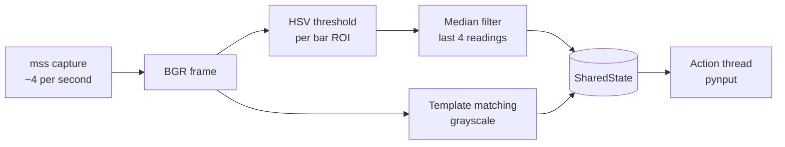
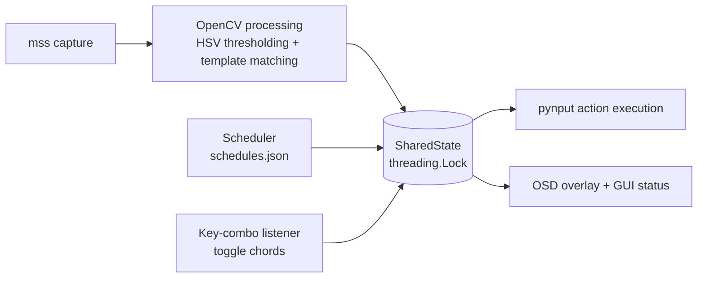

<div align="center">

# 🍄 MushroomGameHelper

**A classical computer-vision assistant for 2D pixelated games: it watches your screen, reads your health and mana bars, and presses the right keys at the right time.**


[Quick Start](#quick-start) · [GUI Walkthrough](#gui-walkthrough) · [Advanced Features](#advanced-features) · [OSD & Telemetry](#osd-telemetry) · [Troubleshooting](#troubleshooting)

</div>

## 🍄 What It Does

MushroomGameHelper takes a picture of a rectangle of your screen four times a second, measures how full your **health** and **mana** bars are using plain colour maths (no machine learning), and presses your potion keys when a bar runs low. It can also press buffs on a timer and hold a loot key for you. Everything is set up from one tabbed window, and a small in-game overlay shows what the bot is doing.

| Feature | What it does | Where you set it up |
| --- | --- | --- |
| **Auto-heal / auto-mana** | Presses your HP/MP key while a bar is below its threshold (with a cooldown). | **Dashboard** → *Resource Monitoring* |
| **Timed buffs** | Presses a key every *N* seconds. | **Manage Buffs** tab |
| **Autolooting** | Holds a loot key and re-presses it on an interval so the game never ignores it. | **Dashboard** → *Action Toggles & Keybinds* |
| **Dynamic window tracking** | Follows the game window when you move it. | **Dashboard** → *Game Window Targeting* |
| **Key capture** | Records any key, media key or mouse button for you. | **Capture** buttons |
| **OSD overlay** | Always-on-top status box: HP, MP, toggles, recent key presses and buff timers. | Appears automatically with the GUI |

| Layer | Technology | Role |
| --- | --- | --- |
| Capture | `mss` | Grabs the configured screen region. |
| Vision | `OpenCV` + `NumPy` | HSV colour thresholding for bars, template matching for sprites. |
| Input | `pynput` | Presses/holds keys and mouse buttons, and listens for the toggle hotkeys. |
| Interface | `Tkinter` | Tabbed GUI and the on-screen display. |
| Language | Python 3.10+ | Three cooperating threads: vision, scheduler, action. |


> [!NOTE]
> This project was built for learning and reliability. Use it responsibly and only in games whose terms of service permit automation.

---

## 📑 Table of Contents

1. [🚀 Quick Start](#quick-start)
2. [🖥️ GUI Walkthrough](#gui-walkthrough): [Dashboard](#tab-1-dashboard) · [Calibrate Bars](#tab-2-calibrate-bars) · [Manage Buffs](#tab-3-manage-buffs)
3. [🧠 Advanced Features](#advanced-features): [Dual-Key Toggles](#dual-key-toggles) · [Key Capture](#key-capture) · [Dynamic Window Tracking](#dynamic-window-tracking)
4. [📺 OSD & Telemetry](#osd-telemetry)
5. [🛡️ Platform Notes](#platform-notes)
6. [🩺 Troubleshooting Matrix](#troubleshooting)
7. [📁 Commands, Files and Configuration](#reference)
8. [🏗️ Architecture](#architecture)

---

<a id="quick-start"></a>

## 🚀 Quick Start

Four steps from a fresh download to a running bot:

- [ ] **Step 1: Install.** You need **Python 3.10 or newer**. Open a terminal in the project folder (the one containing `main.py`) and run:

  ```bash
  python -m pip install --upgrade pip
  pip install -r requirements.txt
  python -c "import tkinter; print('Tkinter OK')"
  ```

  Tkinter is **not** installable with `pip`. If the last command prints an error, install it for your system:

  | OS | Command / action |
  | --- | --- |
  | **Windows** | Built in. If missing, re-run the python.org installer and tick **tcl/tk and IDLE**. |
  | **macOS** | Built in with python.org installers. With Homebrew: `brew install python-tk` |
  | **Ubuntu / Debian** | `sudo apt-get install python3-tk` |
  | **Fedora** | `sudo dnf install python3-tkinter` |

- [ ] **Step 2: Run `python main.py --gui`.** Start your game first, in **Windowed** or **Borderless Windowed** mode (not exclusive fullscreen), and make sure both bars are visible. The window list is read when the GUI opens, so the game must already be running. Then launch the app:

  ```bash
  python main.py --gui
  ```

  `python main.py` (no arguments) and `python gui.py` open the same window.

- [ ] **Step 3: Select Window.** On the **Dashboard** tab, open the **Game Window Targeting** group and choose your game in the **Game Window** dropdown. The capture region now follows that window, even if you move it ([details](#dynamic-window-tracking)). No dropdown (macOS, Linux, or `pygetwindow` unavailable)? Tick **Show Advanced (Manual Coordinates)** and enter the **Top / Left / Width / Height** of the game area instead.

- [ ] **Step 4: Calibrate.** Open the **Calibrate Bars** tab and click **Launch Bar Calibrator**. For **Health** and then **Mana**: drag a box around the bar, click a pixel in the *full* part, click a pixel in the *empty* part. The calibrator saves and closes by itself, **Start** unlocks, and you land back on the **Dashboard**.

Last check before you press **Start**: confirm the **HP/MP Threshold %**, **Keybind** and **Cooldown** in **Resource Monitoring** match your game (defaults: `h` and `m`, low below 40 %, 1 s cooldown). Then press **Start** and **click on the game window** so it receives the key presses.

> [!TIP]
> Hover over any field on the Dashboard for a short explanation. If a value is wrong, a **Configuration Error** pop-up tells you which field to fix.

---

<a id="gui-walkthrough"></a>

## 🖥️ GUI Walkthrough

`python main.py --gui` is the **single entry point** for setup, calibration, buff management and running the bot. The window has three tabs:

| Tab | Purpose |
| --- | --- |
| **Dashboard** | Everything you tune while playing: window targeting, resource thresholds, toggles and keybinds, plus **Start** / **Stop** and the live status. |
| **Calibrate Bars** | Teach the bot where your health and mana bars are and which colours they use. |
| **Manage Buffs** | Add, enable/disable and delete timed buff/potion schedules. |

### First-run check

When the window opens, the app verifies that `calibration.json` exists and that the **Health** and **Mana** bar rectangles are real (positive size and not the built-in placeholders). If not:

- the **Start** button is disabled,
- the status line reads *"Setup Incomplete: Please calibrate your bars in the 'Calibrate Bars' tab before starting."*,
- the **Calibrate Bars** tab is selected for you.

<a id="tab-1-dashboard"></a>

### Tab 1: Dashboard


*A screenshot of the main GUI Dashboard tab showing the grouped sections (Game Window Targeting, Resource Monitoring, Action Toggles & Keybinds) and the "Capture" buttons next to the keybind fields.*

Settings are grouped into three boxes. **Start**, **Stop** and the status area sit below them.

#### 🪟 Game Window Targeting

| Control | Built-in default | Meaning |
| --- | --- | --- |
| **Game Window** | none | Dropdown of the windows that were open when the GUI started. Picking one turns on [Dynamic Window Tracking](#dynamic-window-tracking) and fills the coordinate fields with the window's current position. Disabled if window lookup is unavailable on your system. |
| **Show Advanced (Manual Coordinates)** | off (on if there is no window list) | Shows or hides the four coordinate fields below. |
| **Top**, **Left** | `0`, `0` | Pixel position of the capture rectangle's top-left corner, relative to the primary monitor. Used as the fallback when no window is selected or found. |
| **Width**, **Height** | `800`, `600` | Size of the capture rectangle in pixels (at least 1). |

#### ❤️ Resource Monitoring

| Control | Built-in default | Meaning |
| --- | --- | --- |
| **Match threshold** | `0.8` | Confidence required for template matching, from `0.0` to `1.0`. Higher values reduce false positives. |
| **HP Threshold %** / **MP Threshold %** | `40` / `40` | The bar counts as *low* below this percentage (0-100). |
| **HP Keybind** / **MP Keybind** | `h` / `m` | Key pressed while the bar is low. Type a name or click **Capture**. |
| **HP Cooldown** / **MP Cooldown** | `1.0` / `1.0` | Minimum seconds between two automated presses of that key. |

#### 🔀 Action Toggles & Keybinds

| Control | Built-in default | Meaning |
| --- | --- | --- |
| **Repot Toggle 1 / 2** | `ctrl` + `r` | The two keys pressed together to switch *Re-poting* on or off. |
| **Rebuff Toggle 1 / 2** | `ctrl` + `b` | The two keys pressed together to switch *Re-buffing* on or off. |
| **Looting Toggle 1 / 2** | `ctrl` + `l` | The two keys pressed together to switch *Autolooting* on or off. |
| **Looting Keybind** | empty | Key (or mouse button) held down while Autolooting is ON. **Empty means looting is disabled.** |
| **Looting Interval** | `5.0` | Seconds the key stays held before it is released and pressed again, to defeat the game engine's ignore-timers. |

Every key field has a **Capture** button. See [Key Capture](#key-capture) and [Dual-Key Toggles](#dual-key-toggles).

#### ▶️ Start, Stop and status

| Element | What it does |
| --- | --- |
| **Start** (green) | Validates **every** field, applies them, re-checks calibration and starts the vision, scheduler and action threads. Disabled while running or until the bars are calibrated. |
| **Stop** (red while the bot runs) | Stops all threads, releases any held key and saves your settings to `calibration.json`. Disabled while idle. |
| **Status line** | **Green** while `Running`, **red** for errors and blocked states (invalid settings, setup incomplete, could not start), **grey** otherwise (ready, stopped). |
| **Info panel** | Live readout, refreshed four times per second (sample below). |

```text
Targets visible: False
Health: 85% (low: False)
Mana: 40% (low: True)
Matches: -
Buffs:
  Attack Buff [f1] every 180s - next in 62.3s
Looting: Inactive (Press ctrl+l to toggle)
```

The last line is the looting status: `Looting: ACTIVE` while the loot key is being held, otherwise `Looting: Inactive` plus the chord that switches it on.


> [!NOTE]
> The panel shows `Health: 0%` before you press **Start** because vision has not reported yet. That is normal.

**Tooltips and error pop-ups.** Hovering over a label or field shows a short tooltip (for example **Match threshold**: *"Confidence required for template matching (0.0 to 1.0). Higher values reduce false positives."*). If you enter something invalid, such as a letter in a number field, a **Configuration Error** dialog names the field and what is wrong, and **nothing is applied**: settings are validated all at once, so a typo never leaves you half-configured. The same dialog reports a bot that could not start, a calibrator that could not launch, or a key capture that failed.

Settings are applied when you press **Start**, and saved to `calibration.json` when you press **Stop**, close the window, or launch the calibrator. Closing the window also stops the bot, releases all keys and shows a short thank-you pop-up.

<a id="tab-2-calibrate-bars"></a>

### Tab 2: Calibrate Bars


*A screenshot of the OpenCV calibrator window showing the thick green ROI boundaries, the black-and-white instruction panel, and the color-picker circle indicator.*

Click **Launch Bar Calibrator**. The main window hides itself, and a screenshot of your capture region opens in an OpenCV window titled **Calibrator**. (The tab reminds you: *"Calibration saves directly to calibration.json"*.)

> [!IMPORTANT]
> The screenshot is taken the moment the calibrator starts. If a **Game Window** is selected and found, the calibrator captures **that window** (and records its position and size in `calibration.json`); otherwise it uses the manual **Top / Left / Width / Height** values. Make sure the game, with both bars visible, is on screen and nothing (including your terminal) covers it. Stop the bot before launching the calibrator.

What you see in the Calibrator window:

| Element | Purpose |
| --- | --- |
| **Thick green rectangle** | The *region of interest* (ROI) you drag around a bar, labelled with the bar's name. |
| **Black panel with white text** (top-left) | Tells you what to do next, for example `Health: drag a box around the bar  [r=redo q=quit]`. |
| **Colour-picker circle** | A small circle that follows your mouse during the click steps, filled with the colour under the pointer, so you can see what you are about to pick. |

For **Health** first, then **Mana**, repeat three actions:

1. **Drag the ROI.** Click and drag a tight rectangle around the bar.
2. **Click Full.** Click one pixel in the **filled** part of the bar, inside your rectangle.
3. **Click Empty.** Click one pixel in the **empty** (background) part of the bar, also inside your rectangle.

Clicks outside the rectangle are ignored. Keys in the OpenCV window:

| Key | Effect |
| --- | --- |
| **r** | Redo the bar you are currently on. |
| **q** or **Esc** | Cancel; nothing is saved. |
| Closing the window with the title-bar button | Also cancels; nothing is saved. |


**Then answer the terminal prompts** (the OpenCV window closes and the calibrator asks, for each bar):
As soon as the Mana bar is done, the calibrator writes `calibration.json` and closes. The main window comes back by itself, reloads the file, enables **Start** and returns you to the **Dashboard**. If you cancel, the main window comes back too and nothing changes.

> [!NOTE]
> The calibrator only learns **where the bars are and which colours they use**. The thresholds, keys and cooldowns are set in **Resource Monitoring** on the Dashboard, and are kept when you recalibrate.

> [!WARNING]
> **Do not resize the game window, and do not move it unless [Dynamic Window Tracking](#dynamic-window-tracking) is on.** Bar positions are stored as pixel offsets inside the capture rectangle. Without tracking, a moved window makes the bot look at the wrong place; with tracking, moving is safe but **resizing or changing the in-game resolution or UI scale still requires recalibration**.

> [!TIP]
> Calibrate while a bar is steady (not flashing). Click the middle of the filled and empty parts, away from borders, text and glow.

<a id="tab-3-manage-buffs"></a>

### Tab 3: Manage Buffs


*A screenshot of the "Manage Buffs" tab showing the Treeview table with columns for Name, Keybind, Interval, and Enabled status.*

This tab edits `schedules.json` for you (it replaces the old `buff_setup.py` script).

| Column | Meaning |
| --- | --- |
| **Name** | A unique label, for example `Attack Buff`. |
| **Keybind** | One character (`f`) or a key name (`f1`, `space`). |
| **Interval** | Seconds between automatic presses (greater than 0). |
| **Enabled** | `Yes` or `No`. Disabled schedules are kept but never fire. |


- **Add** opens a small form for **Name**, **Keybind** and **Interval (s)**; click **Save**. Empty fields, a non-positive interval, or a duplicate name are rejected with a message.
- **Add** opens a small form for **Name**, **Keybind** and **Interval (s)**; click **Save**. Empty fields, a non-positive interval or a duplicate name are rejected with a message.
- **Toggle**: select a row, then click **Toggle** to enable or disable it.
- **Delete**: select a row, then click **Delete**.

The table is reloaded from `schedules.json` every time you open the tab, and every change is written immediately.

> [!NOTE]
> The scheduler reads `schedules.json` **when the bot starts**. After changing buffs, press **Stop** and then **Start**. A buff that has never fired is due **immediately** after **Start**, then every *Interval* seconds. Buff keys are pressed one after another with a 0.15 s gap so keystrokes never overlap.

---

<a id="advanced-features"></a>

## 🧠 Advanced Features

<a id="dual-key-toggles"></a>

### Dual-Key Toggles (Looting / Repot / Rebuff)

Each switch is flipped with a **two-key chord**: press **Toggle 1** and **Toggle 2** together, in any order. A background `pynput` listener watches for the chords **while the bot is running** and flips a flag; only the action thread ever touches the keyboard.

| Switch | Default chord | OSD line | What it does |
| --- | --- | --- | --- |
| **Looting** (Autolooting) | `ctrl` + `l` | `Autolooting: [ON]` | **Holds your loot key down**, re-pressing it every *Looting Interval* seconds (see below). |
| **Repot** (Re-poting) | `ctrl` + `r` | `Re-poting: [ON]` | Status flag shown in the [OSD](#osd-telemetry) and written to the log. |
| **Rebuff** (Re-buffing) | `ctrl` + `b` | `Re-buffing: [ON]` | Status flag shown in the [OSD](#osd-telemetry) and written to the log. |

Rules of thumb:

- Left and right modifier keys count as the same key (`ctrl` matches either Ctrl).
- The chord fires **once per press**: holding the keys does not toggle repeatedly.
- Give each switch its **own pair**. If two switches share a pair, only one of them reacts.
- Chords are read when you press **Start**; after changing them, **Stop** and **Start** again.
- Looting starts **OFF** every time the bot starts, and every held key is released when it stops.

> [!NOTE]
> In this version the **Repot** and **Rebuff** switches are *status flags*: flipping them updates the OSD and the log (and the shared state, for your own extensions), but they do not pause the HP/MP presses or the buff schedules. To stop a buff from firing, disable it in **Manage Buffs**. **Looting** is the only switch that changes what the bot presses.

#### Looting: hold and re-trigger

While looting is **ON**, the bot holds your **Looting Keybind** so you can walk over drops and pick them up hands-free. Some game engines ignore a key that has been held for a long time (an "ignore timer"), so every **Looting Interval** seconds (default **5**) the bot **releases** the key, waits 50 ms so the game registers the release, then **holds it again**.

1. Set **Looting Keybind** (for example `x`, or `mouse_left`). It is **empty by default**, which disables looting.
2. Optionally adjust **Looting Interval**.
3. Press **Start**, click the game, and press the looting chord (default **Ctrl + L**). Press it again to stop; the key is released immediately.

You can see the state in the Dashboard (`Looting: ACTIVE` / `Looting: Inactive (...)`) and in the OSD (`Autolooting: [ON]` / `[OFF]`).

> [!WARNING]
> Never use the **Looting Keybind** as a heal, mana or buff key. The bot refuses to tap the looting key for those and logs `Refusing to tap '...': it is the looting hold key.` (or `Skipping buff key '...'`).

<a id="key-capture"></a>

### Key Capture (media keys and mouse buttons)

Next to every keybind field is a **Capture** button, so you never have to guess how a key is spelled.


*A screenshot of the "Capture" dialog popup waiting for user input, demonstrating how users bind media keys or mouse buttons.*

1. Click **Capture**. A small **Key Capture** dialog opens: *"Press any key or mouse button..."*.
2. Press the key, or click the mouse button, you want to bind. The **first** input wins.
3. The dialog closes and the field is filled in with the right name.

| You press | The field receives |
| --- | --- |
| A letter or digit | The character, in lower case (`x`, `5`). |
| A named key | Its name (`f5`, `space`, `enter`, `tab`, `up`, ...). |
| A modifier | `ctrl`, `shift`, `alt` or `cmd` (left and right variants are folded together). |
| A media key | `media_play_pause`, `media_volume_up`, `media_volume_down`, `media_volume_mute` (and other `pynput` media names such as `media_next`). |
| A mouse button | `mouse_left`, `mouse_right` or `mouse_middle`. |

> [!NOTE]
> Capture listens **globally** for the next key or click, anywhere on screen, and gives up after **30 seconds** (the status line says *"Key capture timed out"*). Because of this, clicking the dialog's own title bar can record `mouse_left`; if a field shows something you did not intend, just capture again or type the value. On **macOS** the terminal needs **Input Monitoring** permission or no input will ever arrive (see [Platform Notes](#platform-notes)).

You can also type a name by hand: a single character, any `pynput` key name (`f1`, `space`, `page_up`), or one of the special names above. Names the bot cannot press are only reported in `bot_session.log` (`Unknown keybind: ...`), so prefer **Capture** to avoid typos.

<a id="dynamic-window-tracking"></a>

### Dynamic Window Tracking

**No more broken bots if you accidentally move the game window!** Instead of capturing a fixed rectangle of your desktop, the bot finds the game window by its title and follows it wherever you drag it.

1. **Start the game first** and leave it open (not minimized). The **Game Window** dropdown is filled once, when the GUI opens, so restart the GUI if you launched the game afterwards.
2. In **Game Window Targeting**, pick your game in the **Game Window** dropdown. The window's current position and size are copied into the manual coordinate fields (tick **Show Advanced** to see them).
3. Press **Start**. A line such as `Window 'MyGame' found: {...}` appears in `bot_session.log`. The calibrator also captures the selected window instead of the manual region.

> [!TIP]
> Tracking uses an **exact** title match when one exists; otherwise the first window whose title **contains** the text. Picking a title from the dropdown always gives an exact match. To go back to **fixed coordinates**, close the app, set `"window_title": ""` under `capture` in `calibration.json`, and reopen it.

#### How it behaves

- The window position is checked when the bot starts and again **every 5 seconds** (`WINDOW_REFRESH_INTERVAL` in `config.py`), so after you drag the window the bot follows within 5 seconds.
- **Minimized or hidden window:** the bot keeps the last known good position and logs a warning. When you restore the window it re-acquires it within 5 seconds. It never captures an empty or invalid region.
- **Window not found** (closed, unsupported OS, no permission): the bot falls back to the manual coordinates, logs `Window '...' not found`, and keeps retrying.
- **Partly off-screen:** the capture is cropped to the visible part and a warning is logged, because bars near a cut-off edge may be misread. A window that is entirely off-screen is treated like a minimized one.
- **Size changed:** the window's position and size are saved when you calibrate. If the size later differs, a `Window size ... differs from the size at calibration` warning is logged.

> [!WARNING]
> **Limitations.** Tracking follows the window's **position**, not the picture inside it. If you change the game's **internal resolution** or resize the window, the bars are no longer where calibration recorded them, so you **must recalibrate**. A game in **exclusive fullscreen** may not appear as a normal window (or may capture as black): switch to **Windowed** or **Borderless Windowed**. Window lookup relies on `pygetwindow`, which in practice works on **Windows** only.

<details>
<summary><b>👁️ How the bot sees: vision pipeline and temporal filtering</b></summary>



**Reading a bar.** Colours are easier to compare in **HSV** (hue = which colour, saturation = how vivid, value = how bright) than in RGB. During calibration the two pixels you clicked become two colour ranges, *occupied* and *empty*, each ±15 hue and ±40 saturation/value around your sample. For every frame, inside the ROI only:

- `occupied` = number of pixels inside the occupied range,
- `empty` = number of pixels inside the empty range,
- `percent = 100 × occupied ÷ (occupied + empty)`.

Pixels matching neither range (borders, digits, glow) are **ignored**, so decorations don't distort the reading. A ROI that falls partly or fully outside the captured frame is clipped safely.

**The temporal median filter.** Low bars in many games **flash**, so single readings jump around (for example `20, 100, 20, 100`). The bot keeps the **last 4 readings** (`SMOOTHING_WINDOW`, about 1 s) and reports their **median**, so one flashed frame never changes the result while a real, sustained change takes over within about a second.

- Frames with **no reading** (bar hidden, ROI misaligned) are **skipped**, not counted as 0 %, so a hidden bar never triggers a false "low".
- Until the first valid reading, the bar is treated as **100 %** (not low).
- A bar is *low* when its filtered percentage is below its threshold.

**Template matching.** Each registered template is searched in the grayscale frame with OpenCV's normalised cross-correlation (`TM_CCOEFF_NORMED`) and results become `Targets visible` / `Matches` in the Dashboard info panel.

**Known limitation.** Red bars near hue 0/179 are clipped, not wrapped around the hue circle, so they may need manual edits to the `*_lower` / `*_upper` values in `calibration.json`.

</details>

<details>
<summary><b>🖼️ Optional: add your own sprite templates</b></summary>

Template matches appear in the info panel (`Targets visible`, `Matches`). **No key press currently depends on them**; they are published for your own extensions.

1. Crop the sprite from a screenshot at native size (no scaling) and save it as PNG, for example `templates/slime.png`.
2. Register it in `config.py`:

   ```python
   TEMPLATES: Dict[str, str] = {"slime": "templates/slime.png"}
   ```

3. Optionally set a per-template confidence: `TEMPLATE_THRESHOLDS = {"slime": 0.9}`. Otherwise the **Match threshold** from the Dashboard is used.

Missing template files are skipped silently.

</details>

---

<a id="osd-telemetry"></a>

<details>
<summary><b>⌨️ Key Capture</b></summary>

The capture buttons in the Dashboard and config screens let you bind any supported key, media key, or mouse input without typing raw names by hand. This is useful for actions like `media_play_pause`, `volume_mute`, or a mouse click in a game that does not expose a simple text keybind.

- Press the **Capture** button next to a setting.
- The dialog listens for the next single input only.
- The captured value is written back into the field immediately and is saved with the rest of your configuration.
- If you need to bind a modifier combination or a more complex chord, use the normal config fields directly and keep the capture dialog for quick single-input assignments.

</details>

<details>
<summary><b>📺 On-Screen Display (OSD) &amp; Telemetry</b></summary>
## 📺 OSD & Telemetry

### The on-screen display (OSD)

The OSD opens **automatically together with the GUI**: a small, borderless, semi-transparent, always-on-top box in the top-left corner of the screen. It is **read-only**, refreshes four times per second, and shows `--%` until the bot has started.


*A screenshot of the game with the semi-transparent, click-through OSD overlay in the corner, displaying HP, MP, Looting status, and the recent keypress history.*

```text
HP: 85%
MP: 40%
Autolooting: [ON] (Toggle: ctrl+l)
Re-poting: [OFF] (Toggle: ctrl+r)
Re-buffing: [OFF] (Toggle: ctrl+b)
Recent Actions: 14:02:11 - Pressed 'h' | 14:02:19 - Pressed 'f1' | 14:02:25 - Pressed 'x'
Active Buffs: [Attack Buff [f1], Defense Buff [f2]]
Buff countdowns: Attack Buff in 62.3s | Defense Buff in 120.0s
```


- On Windows, click-through is enabled by default via `CLICK_THROUGH = True` in `osd.py`, and the overlay must be closed with **Ctrl+C** in the terminal.
- To close the overlay with **Esc** instead, set `CLICK_THROUGH = False` in `osd.py`; the overlay will then intercept mouse clicks over its area.
- Transparency is controlled by `ALPHA = 0.8` in `osd.py`.

It refreshes 4 times per second and is **read-only**. Held keys are released when the session exits.


| Line | Meaning |
| --- | --- |
| `HP` / `MP` | Smoothed bar percentages. |
| `Autolooting` / `Re-poting` / `Re-buffing` | Current state of each [dual-key toggle](#dual-key-toggles) and the chord that flips it. |
| `Recent Actions` | The last three keys the bot pressed, with the time of day. |
| `Active Buffs` | The enabled buff schedules and their keys. |
| `Buff countdowns` | Seconds until each enabled buff is pressed next. |

| OS | Behaviour |
| --- | --- |
| **Windows** | **Click-through**: mouse clicks pass straight through the overlay to the game, and it never takes focus (so **Esc** does nothing). It closes with the app. |
| **Linux / macOS** | No click-through in plain Tkinter, so the overlay can take focus and **Esc** closes just the overlay. Transparency needs a compositing window manager, and "always on top" may be ignored by exclusive-fullscreen games, so use borderless-windowed mode. |

Tweak it in `osd.py`: `ALPHA` (opacity, default `0.8`), `POSITION` (default `"+10+10"`), `FONT`, `FG_COLOR`, and `CLICK_THROUGH`.

#### Headless runs

| Command | What it does |
| --- | --- |
| `python main.py --osd` | Runs the bot **without** the main window but with the overlay. Close the overlay or press **Ctrl+C** in the terminal to stop. |
| `python main.py --headless` | Runs the bot with no window at all (any argument other than `--gui` / `--osd` does this). Press **Ctrl+C** to stop. |

> [!WARNING]
> Headless modes skip the GUI's first-run check and its error pop-ups. Calibrate once through the GUI before using them.

### Telemetry: `bot_session.log`

Every run writes a rotating log file, **`bot_session.log`**, in the project folder (max 5 MB per file, 3 backups). Each line has a timestamp, the thread name (`vision`, `action`, `scheduler`, ...), a level and a message. Follow it live while the bot runs:

```bash
# macOS / Linux
tail -f bot_session.log
# Windows PowerShell
Get-Content bot_session.log -Wait -Tail 20
```

| Message | Meaning |
| --- | --- |
| `Bot session starting. Config: ...` | The settings the session started with. |
| `Triggered h due to low health` | A heal/mana key was pressed. |
| `Suppressed h press: cooldown active (0.42s remaining)` | The bar is low but the cooldown has not elapsed. |
| `Scheduling buff press: f1` | A buff came due. |
| `looting_active toggled: looting_active=True` | A toggle chord was detected (`repot_active` / `rebuff_active` for the other two). |
| `Looting: holding 'x'` | The loot key is being held. |
| `Refusing to tap 'x': it is the looting hold key.` | A heal/buff key clashes with the loot key. Pick a different key. |
| `bar_percent returned None for health on 3 consecutive frames` | The ROI is misaligned or the bar is hidden. Recalibrate. |
| `Window 'MyGame' found: {...}` | Window tracking located the game at session start. |
| `Window '...' not found; ...` | The window is closed or minimized; the last known (or fixed) region is used. |
| `Window size ... differs from the size at calibration` | The game was resized or its resolution changed. Recalibrate. |
| `Window '...' is partly off-screen; capture clamped ...` | Drag the game window fully on-screen. |
| `Error in vision: ...` (or `action`, `scheduler`) | A loop iteration failed (the loop keeps running); the traceback follows. |

---

<a id="platform-notes"></a>

## 🛡️ Platform Notes

Screen capture (`mss`) and input control (`pynput`) are things operating systems deliberately restrict. Most "it does nothing" reports are a missing permission, not a bug.

> [!IMPORTANT]
> Key presses go to whatever window has focus. **Click on the game window** after pressing **Start** so it receives the keys.

### 🪟 Windows

- If the bot reads the bars but the game **ignores the key presses**, run your terminal **as Administrator** (right-click → *Run as administrator*) and launch the app from there. Windows blocks a normal program from sending input to an elevated one, so if the game runs as administrator, the bot must too.
- Use **Windowed** or **Borderless Windowed** mode; exclusive fullscreen often captures a black image.
- Window tracking and the **Game Window** dropdown rely on `pygetwindow`, which works on Windows.

### 🍎 macOS

Grant your **terminal app** (Terminal, iTerm, VS Code, or the Python you launch from) these permissions, then **fully quit and reopen the terminal**:

| Permission | Path (macOS 13 and later) | Needed for |
| --- | --- | --- |
| **Screen Recording** | **System Settings → Privacy & Security → Screen Recording** | `mss` screen capture (without it you get a blank or desktop-only image). |
| **Accessibility** | **System Settings → Privacy & Security → Accessibility** | `pynput` pressing keys. |
| **Input Monitoring** | **System Settings → Privacy & Security → Input Monitoring** | `pynput` hearing the toggle chords and the **Capture** dialog. |

On macOS 12 and earlier the same switches live under **System Preferences → Security & Privacy → Privacy**. Window tracking has limited support on macOS; use **Show Advanced (Manual Coordinates)** and keep the window still.

### 🐧 Linux

- Install Tkinter: `sudo apt-get install python3-tk` (Debian/Ubuntu) or `sudo dnf install python3-tkinter` (Fedora).
- Use an **X11 (Xorg)** session. **Wayland** blocks both screen capture and synthetic input for security, so `mss` and `pynput` typically return black images or do nothing. At the login screen choose the "on Xorg" / "X11" session.
- Window tracking is not available on most Linux setups: use manual coordinates and keep the window still.

---

<a id="troubleshooting"></a>

## 🩺 Troubleshooting Matrix

| Symptom | Root Cause | Solution |
| --- | --- | --- |
| **Bot ignores my inputs** (the bars are read, but the game never reacts) | The game runs **elevated** and Windows blocks input from a normal program; or macOS has not granted **Accessibility** / **Input Monitoring**; or the game does not have focus; or you are on Wayland. | **Windows:** run your terminal **as Administrator** and launch from there. **macOS:** check **Accessibility** (and **Input Monitoring** for hotkeys) for your terminal app, then fully restart it. **Linux:** use an X11 session. Always **click the game window** after pressing **Start**. See [Platform Notes](#platform-notes). |
| **Start is greyed out** / *"Setup Incomplete"* | The bars are not calibrated yet, or `calibration.json` still has placeholder values. | Use the **Calibrate Bars** tab. |
| **"Configuration Error" pop-up** | A Dashboard field is empty, negative or not a number (thresholds 0-100, **Match threshold** 0-1, **Width**/**Height** at least 1, **Looting Interval** above 0), or the bot could not start. | Read the message: it names the field. Fix it and press **Start** again. For start-up failures, check `bot_session.log`. |
| **Health / Mana reads 0 % or never changes** | (a) You have not pressed **Start**. (b) The capture region or bar ROI does not line up with the game. (c) A missing OS permission gives a blank capture. | Press **Start**. Check the window selection or the **Top / Left / Width / Height** values, then recalibrate. Look for `bar_percent returned None` in the log. |
| **Bar always reads 0 % or 100 %**, or readings are wrong after moving or resizing the game | Wrong ROI or colours, or the window moved or was resized without tracking. | Select the game in **Game Window**, keep it at the calibrated size, and recalibrate. |
| **The Game Window dropdown is empty or disabled** | Window lookup (`pygetwindow`) is unavailable on your OS, or the game was started after the GUI. | Start the game, then restart the GUI. Otherwise tick **Show Advanced (Manual Coordinates)** and enter the region by hand. |
| **Bot stops tracking or captures the desktop** | The game window was minimized, closed or moved off-screen. | Restore the window; it is re-acquired within 5 seconds. Check `bot_session.log` for `Window '...' not found`. |
| **Capture button does nothing, times out or shows "Key capture failed"** | No input events reach the app (macOS **Input Monitoring**, Wayland, no display), or nothing was pressed within 30 seconds. | Grant the permission and restart the terminal, use X11 on Linux, then click **Capture** again and press a key promptly. You can always type the key name instead. |
| **Capture recorded `mouse_left` instead of my key** | Capture is global: the click you used to move or focus the dialog counted as the input. | Click **Capture** again and press your key without clicking anything first, or type the value. |
| **Looting does nothing** | **Looting Keybind** is empty (the default), looting is OFF, the chord is not detected (permissions), or the key clashes with a heal/buff key. | Set **Looting Keybind**, press the chord and watch for `Autolooting: [ON]` in the OSD. Look for `Looting: holding` or `Refusing to tap` in the log. |
| **A key is never pressed / the log shows `Unknown keybind: ...`** | The key name is misspelled or is not a valid `pynput` name. | Use the **Capture** button, or a single character / valid key name (`f1`, `space`). |
| **Repot / Rebuff shows ON but nothing changes** | These two toggles are status flags in this version. | They only update the OSD and the log. Disable individual buffs in **Manage Buffs** to stop them. |
| **Buff potions are not casting** | The schedule is disabled, buffs were edited while the bot ran (schedules load at **Start**), the key is wrong, or the game lacks focus. | In **Manage Buffs** make sure the row shows `Yes`, then **Stop** and **Start**. Look for `Scheduling buff press` in the log: if it is there, the problem is key delivery (see the first row). |
| **Keys are stuck down** | The process was killed abruptly (for example `kill -9` or a crash) while a key was held, or looting is ON. | Press **Stop**, close the window or press **Ctrl+C**; all three release held keys. For looting, press the chord again. After a forced kill, tap the stuck key yourself. |
| **GUI disappeared when I launched the calibrator** | It is not frozen: the main window **hides on purpose** while the calibrator runs. | Switch to the **Calibrator** window and finish the steps. To abort, press **Esc** / **q** or close its window. The main window always returns. |
| **Potions are pressed too often or too rarely** | The threshold or cooldown does not suit the game, or the game debounces rapid presses. | Adjust **HP/MP Threshold %** and **Cooldown**. Raise the cooldown if the game ignores repeated presses. |
| **OSD is missing, covers part of the game or cannot be clicked** | A fullscreen-exclusive game hides it; on Windows it is click-through by design; its position is fixed in the top-left corner. | Use **Borderless Windowed** mode. Change `POSITION` or `ALPHA` in `osd.py` to move or fade it. |
| **Settings reverted** | Settings are saved on **Stop**, window close and calibrator launch, not continuously. A crash loses unsaved edits. | Press **Stop** (or close the window) after changing them. |
| **Reds never read correctly** | Hue wrap-around is not handled. | Edit the `*_lower` / `*_upper` values in `calibration.json` by hand. |
| **The GUI does not open** | Tkinter is missing, or there is no desktop session (for example SSH without a display). | Install Tkinter (see [Quick Start](#quick-start)) and run from a desktop session. |

---

<a id="reference"></a>

## 📁 Commands, Files and Configuration

### Command-line arguments

| Command | What it does |
| --- | --- |
| `python main.py --gui` | Opens the tabbed GUI together with the OSD (recommended). |
| `python main.py` | Same as `--gui` when no arguments are given. |
| `python gui.py` | Same as `--gui`. |
| `python main.py --osd` | Runs the bot headless with the overlay. |
| `python main.py --headless` | Runs the bot with no window (any other argument does this); stop with **Ctrl+C**. |
| `python calibrator.py` | Runs the calibrator on its own (the GUI normally launches it for you). |
| `python buff_setup.py` | **Deprecated** CLI buff editor. Use the **Manage Buffs** tab. |

### Generated files

These are created when you use the app and are ignored by git.

| File | Created by | Contents |
| --- | --- | --- |
| `calibration.json` | **Calibrate Bars** tab, **Stop** / close | Capture region and window title, match threshold, Health/Mana calibration, toggles and looting settings. |
| `schedules.json` | **Manage Buffs** tab | The buff/potion schedules. |
| `bot_session.log` | Every run | Rotating telemetry log (see [Telemetry](#osd-telemetry)). |

> [!NOTE]
> The GUI manages `calibration.json` and `schedules.json` for you, so most users never edit them by hand. Edit them only for advanced tweaks, with the app closed. A broken or partly written file falls back to defaults rather than crashing, and files are written atomically to avoid that.

<details>
<summary><b><code>calibration.json</code> in detail</b></summary>

```json
{
  "capture": {"top": 0, "left": 0, "width": 800, "height": 600, "window_title": ""},
  "match_threshold": 0.8,
  "health": {
    "roi": [10, 12, 120, 10],
    "full_lower": [0, 150, 150],  "full_upper": [10, 255, 255],
    "empty_lower": [0, 0, 0],     "empty_upper": [10, 40, 60],
    "threshold_percent": 40.0,
    "keybind": "h",
    "cooldown": 1.0
  },
  "mana": { "...": "same fields as health" },
  "repot_toggle_1": "ctrl",   "repot_toggle_2": "r",
  "rebuff_toggle_1": "ctrl",  "rebuff_toggle_2": "b",
  "looting_toggle_1": "ctrl", "looting_toggle_2": "l",
  "looting_keybind": "x",
  "looting_retrigger_interval": 5.0,
  "looting": {"keybind": "x", "retrigger_interval": 5.0, "toggle_key_1": "ctrl", "toggle_key_2": "l"}
}
```

- `capture.window_title`: the selected **Game Window** (empty = fixed coordinates). When tracking is on, `top` / `left` / `width` / `height` hold the window geometry recorded at calibration, used as the fallback and as the size reference for the resize warning.
- `roi`: `[x, y, width, height]` relative to the capture region.
- `*_lower` / `*_upper`: HSV bounds (OpenCV scale: hue 0-179, saturation/value 0-255).
- `threshold_percent`, `keybind`, `cooldown`: the **Resource Monitoring** values for that bar.
- `repot_*`, `rebuff_*`, `looting_*`: the **Action Toggles & Keybinds** values. The bot reads the top-level `looting_*` keys; the nested `looting` object is a mirror kept for compatibility.
- A key is a single character, a `pynput` key name (`space`, `f1`, ...), or one of `mouse_left`, `mouse_right`, `mouse_middle`, `media_play_pause`, `media_volume_up`, `media_volume_down`, `media_volume_mute`.

</details>

<details>
<summary><b><code>schedules.json</code> in detail</b></summary>

```json
{
  "schedules": [
    {"name": "Attack Buff", "keybind": "f1", "interval_seconds": 180.0, "enabled": true}
  ]
}
```

Invalid entries and duplicate names are skipped when loading.

</details>

<details>
<summary><b>Tunable constants in <code>config.py</code></b></summary>

| Parameter | Default | Meaning |
| --- | --- | --- |
| `VISION_INTERVAL` | `0.25` s | Vision loop period (~4 FPS). |
| `ACTION_INTERVAL` | `0.10` s | Action loop period (~10 Hz). |
| `SCHEDULER_INTERVAL` | `0.20` s | Scheduler loop period (5 Hz). |
| `SMOOTHING_WINDOW` | `4` | Frames in the median filter. |
| `TEMPLATE_THRESHOLDS` | `{}` | Per-template confidence overrides. |
| `WINDOW_REFRESH_INTERVAL` | `5.0` s | How often the game window position is re-checked (`0` disables). |
| `BUFF_INPUT_COOLDOWN` | `0.15` s | Minimum gap between two scheduled buff presses. |
| `DEFAULT_PRESS_DURATION` | `0.05` s | How long a tap is held. |
| `LOOTING_RETRIGGER_GAP` | `0.05` s | Pause between releasing and re-holding the loot key. |

</details>

---

<a id="architecture"></a>

## 🏗️ Architecture



| Module | Role |
| --- | --- |
| `main.py` | Entry point (`--gui`, `--osd`, headless) and the `Runner` that starts/stops the threads. |
| `gui.py` | Tabbed Tkinter front end (**Dashboard**, **Calibrate Bars**, **Manage Buffs**): grouped settings, tooltips, error dialogs and status colours. |
| `key_capture.py` | One-shot key / mouse-button listener behind the **Capture** buttons. |
| `calibrator.py` | Interactive OpenCV tool for bar ROIs and colours; launched from the **Calibrate Bars** tab. |
| `config.py` | Typed configuration; loads and saves `calibration.json` and `schedules.json`. |
| `vision.py` | Capture, HSV bar reading, template matching, median filter, window-following capture region. |
| `state.py` | Lock-protected shared dictionary bridging the threads (all access goes through its lock). |
| `action.py` | The only module that touches the keyboard and mouse: cooldown logic, scheduled buffs, looting hold-and-retrigger, and the dual-key combo listener. |
| `scheduler.py` | Decides which buffs are due (`perf_counter`); never presses keys. |
| `window_manager.py` | Finds the game window by title (`pygetwindow`), rejects minimized windows and clamps the result to the screen bounds reported by `mss`. |
| `osd.py` | Read-only always-on-top overlay. |
| `logger.py` | Rotating session log, `bot_session.log`. |
| `buff_setup.py` | **DEPRECATED**: use the GUI **Manage Buffs** tab instead. |

**Threads:** `vision` (every 250 ms) writes bar percentages and matches to `SharedState`; `scheduler` (every 200 ms) queues due buff keys; `action` (every 100 ms) drains the queue, presses buffs, then applies the looting hold and the heal/mana rules. A fourth `pynput` thread listens for the toggle chords. On **Stop**, all threads and the listener are stopped and every held key is released.
