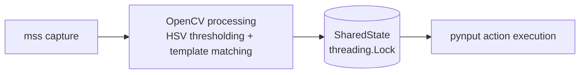

# MushroomGameHelper

A classical computer-vision automation framework for 2D pixelated games. It
watches a screen region, reads health and mana bars, detects sprites and presses
keys for you. It was built for learning (`Tkinter`, `mss`, `OpenCV`, `pynput`,
GitHub Copilot's agentic capabilities) and for reliability: no machine
learning, just simple, predictable image processing.

## ✨ Quick Start (For Beginners)

Never used this tool? Follow these four steps.

- [ ] **Step 1: Install dependencies.** You need Python **3.10 or newer**.

  ```bash
  pip install -r requirements.txt
  ```

  Tkinter (the window toolkit) comes with Python but is sometimes missing:

  | OS | What to do |
  | --- | --- |
  | Windows | Nothing; it is built in (keep "tcl/tk and IDLE" ticked in the python.org installer). |
  | macOS | Built in with python.org installers; with Homebrew run `brew install python-tk`. |
  | Ubuntu / Debian | `sudo apt-get install python3-tk` |
  | Fedora | `sudo dnf install python3-tkinter` |

- [ ] **Step 2: Open the game in Windowed or Borderless Windowed mode** (not
  exclusive fullscreen) and note where the window is on your screen. Keep it
  at a fixed size and position.
- [ ] **Step 3: Start the app.**

  ```bash
  python main.py --gui
  ```

- [ ] **Step 4: Follow the on-screen prompts in the GUI.** If setup is
  incomplete, the app automatically opens the **Calibrate Bars** tab and keeps
  the **Start** button disabled until your bars are calibrated.

> Run the command from the project folder (the one containing `main.py`);
> the calibrator is started relative to the current directory.

## Key Features

- **Real-time screen capture** of a configurable region with `mss`.
- **Interactive bar calibration** for health and mana, launched from the GUI.
- **Temporal median filtering** of bar percentages (rolling window of 4 frames)
  to suppress flashing and opacity artifacts.
- **Decoupled threads**: vision at 250 ms (~4 FPS), action at 100 ms (~10 Hz).
- **Per-key cooldowns** to prevent input spamming.
- **Timed buff/potion schedules** managed in the GUI.
- **Looting hold-and-retrigger** toggled with a key combination.
- **Tabbed Tkinter GUI** (**Dashboard**, **Calibrate Bars**, **Manage Buffs**)
  with live status and persistent settings.

## Step-by-Step Setup and Testing Workflow

### Step 1: The Unified GUI

`python main.py --gui` is the single entry point for both setup and running
the bot:

```bash
python main.py --gui
```

The window has three tabs:

| Tab | Purpose |
| --- | --- |
| **Dashboard** | Capture region, match threshold, **Start**/**Stop**, live status. |
| **Calibrate Bars** | Launch the health/mana bar calibrator. |
| **Manage Buffs** | Add, toggle and delete timed buff/potion schedules. |

On the first run (no valid calibration yet) the **Start** button is disabled,
the status line reads *"Setup Incomplete: Please calibrate your bars in the
'Calibrate Bars' tab before starting."* and the **Calibrate Bars** tab is
selected automatically.

### Step 2: Calibrate Bars Tab

1. Open the **Calibrate Bars** tab and click **Launch Bar Calibrator**.
2. The main window hides itself and a screenshot of the capture region opens in
   an OpenCV window. For **Health** and then **Mana**:
   1. **Click and drag** to draw a rectangle (ROI) tightly around the bar.
   2. **Click** a pixel in the *full / occupied* part of the bar (inside the ROI).
   3. **Click** a pixel in the *empty / background* part of the bar (inside the ROI).
3. Press **r** to redo the current bar, or **q** / **Esc** to cancel without
   saving. Cancelling is safe: the GUI window always comes back.
4. Back in the terminal you launched the GUI from, answer the prompts for each
   bar:

   ```text
   Enter Health % threshold [0-100]:
   Key to press when Health is low:
   Health cooldown in seconds [0-3600]:
   ```

   (and likewise for Mana).
5. The result is saved to `calibration.json`. When the calibrator closes, the
   GUI automatically re-reads that file; if the calibration is valid it enables
   the **Start** button and returns you to the **Dashboard**.

Sampled colors are converted to HSV and expanded by ±15 hue and ±40
saturation/value. **Calibrate again whenever the game resolution, UI scale or
capture region changes.** The calibrator cannot be launched while the bot is
running; press **Stop** first.

### Step 3: Manage Buffs Tab

Use this tab to have the bot press a key on a fixed timer (e.g. a buff every
3 minutes). It replaces the old `buff_setup.py` command-line script.

- The table lists every schedule with the columns **Name**, **Keybind**,
  **Interval** (seconds) and **Enabled**. It is reloaded from `schedules.json`
  each time you open the tab.
- **Add**: opens a small form. Enter a unique **Name**, a **Keybind** (a single
  character or a key name such as `f1`) and an **Interval (s)** greater than 0,
  then click **Save**.
- **Toggle**: select a row, then click **Toggle** to enable or disable it
  without deleting it.
- **Delete**: select a row, then click **Delete** to remove it.

Every change is written to `schedules.json` immediately. Schedules are read
when the bot starts, so press **Stop** and **Start** again after changing them.

### Step 4: Template Setup

1. Crop the sprite from a screenshot at native resolution (no scaling) and save
   it as PNG, e.g. `templates/slime.png`.
2. Register it in `config.py`:

   ```python
   TEMPLATES: Dict[str, str] = {"slime": "templates/slime.png"}
   ```

3. Optionally override the confidence per template with
   `TEMPLATE_THRESHOLDS = {"slime": 0.9}`.

Matches are published as `matches["slime"] = [(x, y, confidence), ...]`.
Missing template files are skipped silently.

### Step 5: Execution

Go to the **Dashboard** tab:

1. Check the capture region fields (**Top**, **Left**, **Width**, **Height**),
   the **Match threshold**, and optionally the **Window Title** (see
   [Troubleshooting](#troubleshooting-and-known-limitations)).
2. Click **Start**. The bot threads begin and the status reads *Running*.
3. Watch the live status panel: health and mana percentages with low flags,
   whether targets are visible, template matches, the buff schedules with
   next-press countdowns, and the looting state.
4. Click **Stop** to halt the bot. Held keys are released and your settings are
   saved to `calibration.json`. Closing the window does the same.

Other ways to run:

```bash
python main.py          # headless; stop with Ctrl+C
python main.py --osd    # headless bot plus on-screen overlay
```

### On-Screen Display (OSD)

`python main.py --osd` starts the bot threads and shows a small borderless, semi-transparent
(80 % alpha), always-on-top window at the top-left of the screen with `HP`,
`MP`, `Looting: ON/OFF` and the enabled buff schedules, refreshed 4 times per
second. The overlay only reads `SharedState` and never changes it. Close it
with **Escape** (while it has focus) or **Ctrl+C** in the terminal; either way
the bot threads are stopped and held keys are released.

OS-specific notes on click-through:

- **Windows:** `osd.py` applies the `WS_EX_TRANSPARENT`/`WS_EX_NOACTIVATE`
  extended styles via `ctypes`, so mouse clicks pass through to the game. As a
  consequence the overlay cannot receive **Escape**; close it with **Ctrl+C**
  in the terminal.
- **Linux/macOS:** plain Tkinter has no click-through support. Only
  `-topmost` and `-alpha` are used, so the overlay can take clicks and focus
  (which makes **Escape** work). Transparency needs a compositing window
  manager, and `-topmost` may be ignored by some X11 window managers or by
  exclusive-fullscreen games; use borderless-windowed mode in the game.

## Looting Automation (Hold-and-Retrigger)

The bot can hold your loot key down for you while you move around.

### How to activate it

Press the configured two-key combination **at the same time** (default
**Ctrl + L**). Press it again to switch looting off, which releases the loot
key immediately. The toggle works while the bot is running (after **Start**, or
with `python main.py --osd`).

### Why it re-triggers automatically

Some game engines ignore a key that has been held down for a long time. While
looting is active the bot therefore releases the loot key and presses it again
every few seconds (default every 5 s), so the game keeps registering it.

### Status

The state is shown in the **Dashboard** live status panel (`Looting: ACTIVE`, or
`Looting: Inactive` followed by the toggle hint) and in the OSD overlay
(`Looting: ON` / `Looting: OFF`).

### Settings

Configure it in the `looting` section of `calibration.json`:

| Field | Default | Meaning |
| --- | --- | --- |
| `keybind` | `x` | Key held while looting. |
| `retrigger_interval` | `5.0` | Seconds before the key is released and re-held. |
| `toggle_key_1` / `toggle_key_2` | `ctrl` / `l` | The toggle combination. |

## Architecture



| Module | Role |
| --- | --- |
| `config.py` | Typed dataclass configuration; loads `calibration.json` if present, otherwise defaults. |
| `vision.py` | Capture, `cv2.matchTemplate`, `cv2.inRange`, bar percentages, median filter. |
| `state.py` | Lock-protected shared dictionary bridging the two threads. |
| `action.py` | Key presses/holds via `pynput`, threshold logic, cooldowns, looting hold-and-retrigger. |
| `main.py` | `Runner` managing the threads; entry point for `--gui` and `--osd`; Ctrl+C triggers graceful shutdown. |
| `scheduler.py` | Time-based buff/potion scheduling (`perf_counter`); decides what is due, never presses keys. |
| `buff_setup.py` | DEPRECATED: Use GUI 'Manage Buffs' tab instead. |
| `gui.py` | Tabbed Tkinter front end (**Dashboard**, **Calibrate Bars**, **Manage Buffs**). |
| `osd.py` | Read-only always-on-top status overlay (`--osd`). |
| `calibrator.py` | Interactive OpenCV calibration tool, launched from the **Calibrate Bars** tab. |
| `window_manager.py` | Finds the game window by title so the capture region can follow it. |
| `logger.py` | Rotating session log (`bot_session.log`). |

The vision thread writes `health_percent`, `mana_percent`, `health_low`,
`mana_low`, `targets_visible` and `matches` to `SharedState`; the action thread
reads a consistent snapshot every tick and presses keys subject to cooldowns.
A third `scheduler` thread (5 Hz) queues due buff keybinds in
`pending_buff_presses`; the action thread drains and presses them, so it remains
the only component that touches the keyboard.

## Configuration Reference

### `config.py`

| Parameter | Default | Meaning |
| --- | --- | --- |
| `VISION_INTERVAL` | `0.25` s | Vision loop period (~4 FPS). |
| `ACTION_INTERVAL` | `0.10` s | Action loop period (~10 Hz). |
| `SMOOTHING_WINDOW` | `4` | Frames in the median filter (1 s at 250 ms). |
| `MATCH_THRESHOLD` | `0.80` | Template match confidence (0-1). |
| `TEMPLATE_THRESHOLDS` | `{}` | Per-template confidence overrides. |
| `KEYBINDS` | see file | Logical-name to key mappings for other actions. |
| `DEFAULT_PRESS_DURATION` | `0.05` s | Key hold time for a tap. |

Health and mana settings (including cooldowns) and the looting settings live in
`calibration.json`.

### `calibration.json`

> **Most users never need to edit this file by hand.** The **Calibrate Bars**
> tab writes the `health` and `mana` sections, and the **Dashboard** tab writes
> the capture region and match threshold when you press **Stop** or close the
> window. Edit it manually only for advanced tweaks (e.g. the `looting`
> section).

```json
{
  "capture": {"top": 0, "left": 0, "width": 800, "height": 600},
  "match_threshold": 0.8,
  "looting": {
    "keybind": "x",
    "retrigger_interval": 5.0,
    "toggle_key_1": "ctrl",
    "toggle_key_2": "l"
  },
  "health": {
    "roi": [10, 12, 120, 10],
    "full_lower": [0, 150, 150],  "full_upper": [10, 255, 255],
    "empty_lower": [0, 0, 0],     "empty_upper": [10, 40, 60],
    "threshold_percent": 40.0,
    "keybind": "h",
    "cooldown": 1.0
  },
  "mana": { "...": "same fields as health" }
}
```

- `roi`: `[x, y, width, height]` relative to the capture region.
- `*_lower` / `*_upper`: HSV bounds (OpenCV scale: H 0-179, S/V 0-255) for the
  occupied and empty colors.
- `threshold_percent`: the bar counts as *low* below this percentage.
- `keybind`: a single character or `pynput` key name (e.g. `space`, `f1`).
- `cooldown`: minimum seconds between presses of that key.
- `looting`: see [Looting Automation](#looting-automation-hold-and-retrigger).

### Percentage and temporal median filter

Per frame, `percent = 100 · occupied / (occupied + empty)` over the ROI. Pixels
matching neither color (borders, text, glow) are ignored. Flashing bars make
single readings jump (e.g. 20, 100, 20, 100), so the last 4 readings are kept
and their **median** is reported. Unlike the mean, the median tolerates outliers:
a single flashed frame never changes the result, and a real change takes over
once it fills about half of the window (~0.5-1 s). Frames where neither color is
found are skipped rather than treated as 0%.

### `schedules.json`

Written by the **Manage Buffs** tab; you normally never touch it.

```json
{
  "schedules": [
    {"name": "Attack Buff", "keybind": "f1", "interval_seconds": 180.0, "enabled": true}
  ]
}
```

## Troubleshooting and Known Limitations

**Do not move the game window after calibrating, or the bot will look at the
wrong place.** The bars are stored as positions inside the capture region. If
you must move the window, update the capture region on the **Dashboard** tab
(or recalibrate). Alternatively, enter part of the game's window title in
**Window Title**; the capture region then follows the window automatically.
This lookup relies on `pygetwindow`, which works on Windows; on Linux/macOS it
falls back to the fixed region, so keep the window still there.

- **Stuck keys:** held keys are released on **Ctrl+C**, on GUI **Stop**, and when
  the GUI window is closed. If the process is killed forcibly (e.g. `kill -9`),
  release them manually.
- **Dropped inputs / game debouncing:** some engines ignore very short presses
  or rapid repeats. Increase `DEFAULT_PRESS_DURATION`, raise the per-key
  `cooldown` in `calibration.json`, or increase `ACTION_INTERVAL`.
- **Start button is disabled:** calibration is missing or still holds the
  placeholder values. Use the **Calibrate Bars** tab.
- **Bar always reads 0 or 100 %:** the ROI or HSV ranges are off; recalibrate and
  make sure the game window did not move.
- **Hue wrap-around:** reds near hue 0/179 are clipped, not wrapped, so a
  red bar may need manual adjustment of the HSV bounds.
- **GUI settings:** edits are saved to `calibration.json` when you press **Stop**
  or close the window; **settings changed during a live session persist only
  after that**, and a hard crash loses them.
- **Latency:** the median filter adds up to about 1 s of delay in reacting to
  genuine changes.
- **macOS / Linux permissions:** screen capture (`mss`) and keyboard control
  (`pynput`) are commonly blocked by the OS.
  - **macOS:** open *System Settings → Privacy & Security* and grant your
    terminal (or Python/IDE) **Screen Recording**, **Accessibility** and
    **Input Monitoring**, then restart the terminal. A black capture or keys
    that do nothing usually mean a missing permission.
  - **Linux:** use an X11 session; Wayland blocks screen capture and input
    simulation.
- Use responsibly and only in games whose terms permit automation.
