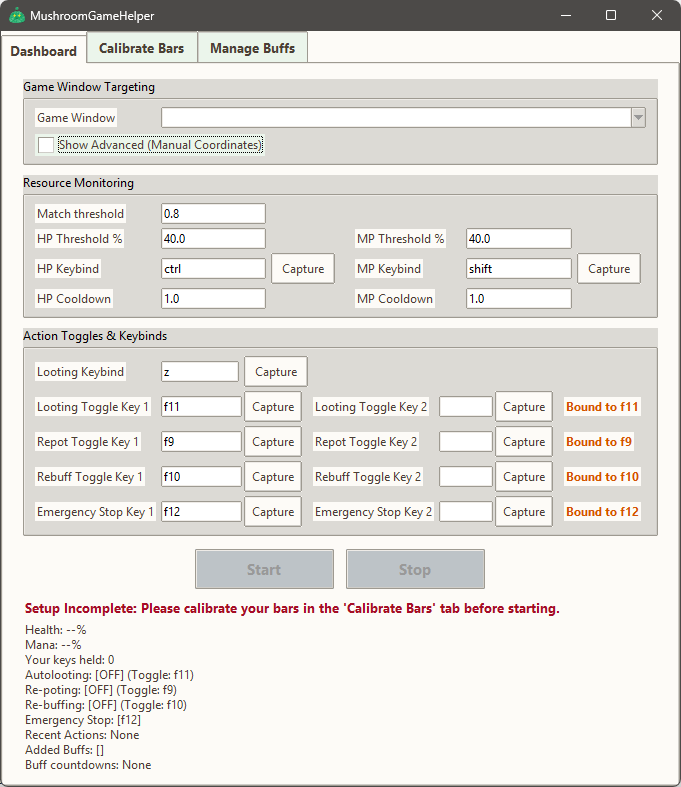
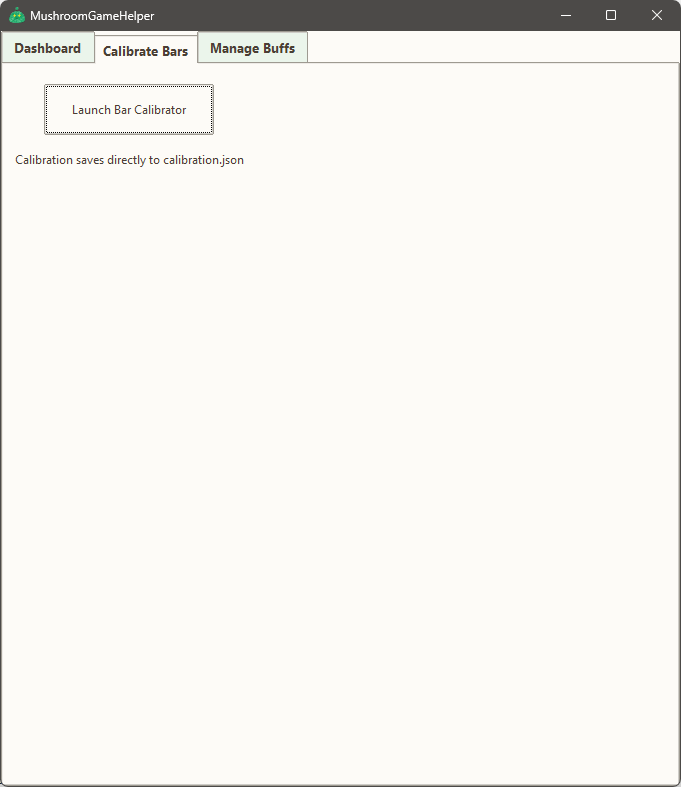
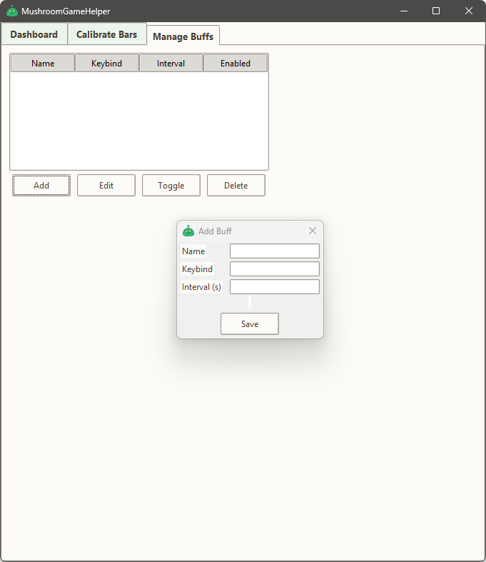

<div align="center">

# 🍄 MushroomGameHelper

**An external computer-vision assistant for 2D pixelated games.**  
It watches your screen, reads your health and mana bars, and presses the right keys at the right time. All of this is done via screen capture without ever reading game memory.


<br>


</div>

---
> [!IMPORTANT]
> Please read [A Note on the Project’s Origins and Philosophy](#philosophy) and [Why use this tool instead of others?](#why-use-this-tool) before you decide if this tool is for you, or if you have reservations about using the tool!

## 📊 Feature Status Map
*Transparency is key. Here is a quick summary of the tool's current capabilities based on inherent the game-engine limitations for the mushroom game.*
<a id="Feature-Map"></a>

| Feature | Functionality Status | Description / features | Caveats & Limitations
| :--- | :--- | :--- | :--- |
| **Auto-Pot (HP/MP)** | 🟢Feature-Complete | Reliable potion usage based on HP/MP bar filled (user-defined %).<br> • Cooldown added to prevent spamming.<br> • In-game screen fadeout aware. | • Potion key-presses will interrupt user-held attack keys in Mushroom game (unavoidable due to game engine behavior).<br> • Resizing the game window after calibration may affect the accuracy of potion usage. |
| **Context-Aware Autoloot** | 🟡Might Require Optimization | Holds the loot key during periods where no user input is detected (null input space) to trigger autoloot.<br> • Retriggers every 2 sec automatically in case in-game UI interaction interrupts the autolooting.<br> • User movement inputs are not considered in the input space based on how they are treated by Mushroom game.| • Autolooting might be interrrupted in certain scenarios due to user input or UI interactions.<br> • This is mitigated somewhat by the automatic retriggering mechanism.* |
| **Timed Autobuff** | 🟠Partial functionality | Automated key-presses for user-defnined buffs.<br> • Rapid double tapping to disrupt any user-held keys before the actual buff-triggerring key press.<br> • Short milisecond cooldowns implemented between buff key-presses due to skill animation lock.|• Buff key-presses will interrupt user-held attack keys in Mushroom game (unavoidable due to game engine behavior)<br> •Buffs may also fail to register when buff key-presses coincide with other user inputs.<br> • Avoid registering buffs with short intervals for best results.|


> [!IMPORTANT]
> **Antivirus False Positives:** Because this tool uses external screen capture (`mss`) and keystroke simulation (`pynput`), Windows Defender may flag the `.exe` as a false positive. This is a standard behavior for all Python automation tools. The code is 100% open-source for verification.

---

## 📑 Table of Contents

**👤 For General Users**
* [Quick Start (Download and extract)](#quick-start)
* [First-Time Setup & Calibration](#first-time-setup)

**💻 For Developers**
* [Build from Source](#build-from-source)
* [Creating an Optimized Executable](#creating-an-optimized-executable)

**📚 Reference**
* [Why use this tool instead of others?](#why-use-this-tool)
* [Architecture & Design](#architecture--design)
* [A Note on the Project’s Origins and Philosophy](#philosophy)

---

## 👤 For General Users

<a id="quick-start"></a>
### Quick Start (Download and extract)
1. Go to the [Releases](https://github.com/pengkenlim/MushroomGameHelper/releases) page.
2. Download the latest `MushroomGameHelper_vX.X.X.zip`.
3. Extract the folder to your Desktop (do not run it from inside the `.zip`).
4. *(Optional but recommended)* Add the folder to your Windows Defender exclusions if flagged.
5. Double-click `MushroomGameHelper.exe`.

<a id="first-time-setup"></a>
### First-Time Setup

1. On first launch, you will need to navigate to the **Dashboard** tab. Select game window from dropdown box. 

> [!TIP]
> **Game window size/resolution matters:** The tool relies on visual cues from the game window. Ensure your game is running at a consistent resolution and is not resized during gameplay for accurate detection. Make any adjustment to your game window size before next step.


   <br>

   
   <br>


2. Go to the **Calibrate Bars** tab and click **Launch Bar Calibrator**.

   <br>

   

   <br>

2. An OpenCV window will appear.


3. Drag a box around your HP bar, click a "Full" pixel, then click an "Empty" pixel. Repeat for MP.
   
   <br>
   
   <br>

> [!TIP]
> **Useful tips:** Try to cover the entire length of the bars when dragging the calibration box for more accurate detection. The width do not matter as much-you can undershot slightly. If your HP or MP bars are full, you can click on the empty portions of the EXP bar to select the "Empty" pixel (assuming that the empty portions of the EXP bar looks the same as the empty portions of HP/MP bars).

4. Return to the **Dashboard**, set your desired thresholds, key-binds and toggle-keys.

> [!TIP]
> **Tooltips are helpful:** Hover over buttons and options in the dashboard to see helpful explanations and guidance.

5. Go to **Manage Buffs** tab to add your buffs.

> [!NOTE]
> **Autobuffing is still not perfect:** Refer to [Feature status map](#feature-map) for more information. If you don't like the current jank of autobuffing functionality, you can still use the autobuffing toggle-key as sort of a manual multi-buff macro by enabling-disabling it as needed. 

   <br>

   
   <br>

6. Go to **Dashboard** tab to press start. An On-Screen display will show the current status of the tool. It is always on top so that you can view it in-game. You can drag it around to reposition it as needed using the right-mouse button.

   <br>
   
   <br>


<a id="why-use-this-tool"></a>
## 🤔 Why use this tool instead of others?

If you've looked into Mushroom game automation before, you've probably seen other tools. Here is how MushroomGameHelper is different.

*   **External-Only (Safer):** It never reads game memory or injects DLLs. It simply watches your monitor and presses keys on your OS, making it indistinguishable (in theory) from a hardware macro keyboard.
*   **Visual Calibration:** No more taking screenshots to find hex codes. The interactive OpenCV GUI lets you just drag a box around your bars and click to calibrate.
*   **Dynamic & Robust:** Built-in dynamic window tracking and temporal median filters mean the bot won't break if you move your game window or if the UI flashes. 
*   **Game-Agnostic:** It doesn't contain a single line of game-specific code. It's a generic 2D side-scroller framework that happens to work on a mushroom game.
*   **Free & Open Source:** Some tools charge for similar functionality, but MushroomGameHelper is completely free. The entire project is freely available and open source, allowing anyone to inspect, modify, and contribute. 
*   **Terms of Service Compliant:** MushroomGameHelper operates entirely externally and does not modify the game client, helping you stay within the game's terms of service. MushroomGameHelper does not fully-automate key gameplay loop actions such as combat or questing.

---

## 💻 For Developers

<a id="build-from-source"></a>
### Build from Source
To run or modify the tool directly from the Python script:

1. **Prerequisites:** Install [Python 3.10+](https://www.python.org/downloads/). Ensure "Add Python to PATH" is checked during installation.
2. **Clone the repository:**
   ```bash
   git clone https://github.com/pengkenlim/MushroomGameHelper.git
   cd MushroomGameHelper
   ```
3. **Create a virtual environment (Recommended):**
   ```bash
   python -m venv venv
   # Windows:
   venv\Scripts\activate
   ```
4. **Install dependencies:**
   ```bash
   pip install -r requirements.txt
   ```
5. **Run the application:**
   ```bash
   python main.py
   ```

<a id="creating-an-optimized-executable"></a>
### Creating an Optimized Executable
To build a lightweight, standalone `.exe` (requires `upx.exe` in the project root for compression):

```bash
pyinstaller --name MushroomGameHelper --noconsole --clean --upx-dir=. --icon="visual_assets\green_blob.ico" --hidden-import=pynput.keyboard._win32 --hidden-import=pynput.mouse._win32 --add-data "visual_assets;visual_assets" main.py
```
*The resulting optimized folder will be located in `dist/MushroomGameHelper`.*

---

## 📚 Reference

<a id="architecture--design"></a>
### Architecture & Design
The tool operates on a multi-threaded, lock-protected architecture to ensure the GUI never freezes and input is handled safely:
* **Vision Thread (`mss` + `OpenCV`):** Captures the screen at ~4 FPS, applies HSV thresholding to the calibrated ROI, and uses a temporal median filter to ignore UI flashes.
* **Scheduler Thread:** Tracks `perf_counter` to determine when timed buffs are due.
* **Action Thread (`pynput`):** The *only* thread that interacts with the keyboard. It handles cooldowns, context-aware looting holds/releases, and buff double-taps.
* **Input Contention Guard:** Monitors physical key presses. If the user exceeds a threshold of held keys, low-priority bot actions (like buffs) are deferred to prevent game engine input buffer overflow.

<a id="philosophy"></a>
### A Note on the Project’s Origins and Philosophy
Hello everyone! I would like to dabble in software engineering as a hobby, but am woefully inexperienced. As such, I built this project primarily as a personal learning exercise and a portfolio piece. To tackle complex topics like multi-threaded architecture and computer vision, I’ve been experimenting with using AI as a pair-programming tutor to help scaffold the initial framework. My goal isn't just to ship a tool, but to iteratively refine, debug, and deeply understand every line of code so I can grow from relying on AI assistance to mastering the underlying software engineering principles myself. I’ve always loved 2D pixelated side-scrollers (a classic version of a mushroom game in particular), and I’m sharing this publicly to learn from this amazing community, catch bugs I couldn't find alone, and hopefully help a few people along the way.

As I developed the tool, I wanted to make sure it respected the spirit of the game(s) we love. Here are a few thoughts on why I built it and how I hope it gets used:

**Preserving the Core Gameplay**
I have immense respect for game design and the effort required to progress. This tool was never meant to play the game *for* you or allow for AFK farming. The core joy of the game—exploring, hunting, and strategizing—still requires your active attention. The goal for this tool is simply to act as a digital assistant for the repetitive micro-management (like watching timers and tapping loot), so players can enjoy the games without it being too much a grind.

**A Humble Accessibility Aid**
During my own long grinding sessions, I noticed my hands getting fatigued and my focus draining from constantly tracking multiple overlapping buff timers and health bars. I realized that this heavy cognitive and motor load can be a genuine barrier to entry, especially for players dealing with repetitive strain, motor challenges, or attention difficulties. I hope this tool can serve as a gentle accessibility bridge, allowing more people to comfortably enjoy the end-game content they love without physical burnout.

**Bridging the Free-to-Play Gap**
In many MMOs, built-in quality-of-life features like auto-looting and auto-buffing are often tied to in-game cash purchases (e.g., premium cash-shop pets in a certain classic mushroom game). As a money-tight and a Free-to-Play (F2P) player, I couldn't always justify those purchases, but I still wanted to enjoy the game comfortably without my hands hurting. I built this as a free, open-source alternative to help bridge that gap for the F2P community. That said, I deeply respect the developers who keep the servers running, and I always encourage supporting them through cosmetics and other official channels!

**A Generic Technical Framework**
From a technical standpoint, the code itself contains no references, memory-reading hooks, or IP-specific data for any particular game. It is entirely blind to what you are playing; it simply watches a configurable rectangle of pixels on your monitor and simulates keystrokes based on the colors it sees. 

Thank you for checking out my project. Whether you use it to save your hands, fork it to learn from the code, or just pass by, I appreciate you taking the time to read this. Please use it responsibly, take care of your health, and happy hunting! 🍄

PS: consider leaving a star on this repo⭐ It gives me a gauge of general interest from the community and keeps me motivated!

> [!NOTE]
> **A Quick Note on the Current State (and a Small Apology!)**
> Because this is an active, solo student learning project, the UI and user experience are still very much a "Work in Progress." You will likely encounter some UI/UX jankiness, unpolished menus, or the occasional bug. I sincerely apologize in advance for these rough edges! I am iteratively refining the tool and learning as I go. If you run into a bug or find a workflow that feels clunky, please open an Issue. Your feedback is genuinely the best way for me to learn what needs polishing next.

---

<div align="center">
  <sub>Built with ❤️ and a lot of OpenCV debugging.</sub>
</div>
